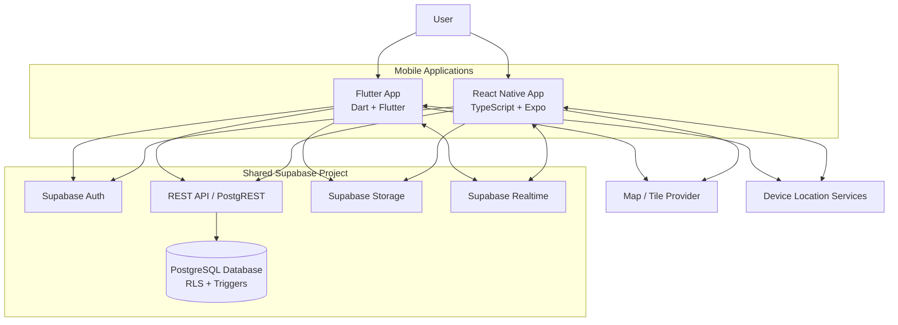

# Real Estate Mobile Services

> A cross-platform real-estate mobile application delivered in two native-feeling client apps — **Flutter** and **React Native + Expo** — powered by one shared **Supabase** backend.

Real Estate Mobile Services connects property seekers and property owners through a shared platform. Users can discover sale and rental listings, search and filter properties, view photos and map locations, publish their own listings, save favorites, contact owners and exchange realtime messages. Both mobile applications use the same Supabase project, allowing a Flutter user and a React Native user to interact with the same properties and conversations.

> **Project structure:** this repository contains two mobile applications and the shared backend configuration/documentation. Each app has its own README with framework-specific setup instructions:
> - [Flutter app](./apps/flutter_app/immobilier/README.md)
> - [React Native app](./apps/react_native_app/immobilier/README.md)


---

## Table of Contents

- [Overview](#overview)
- [Project Goals](#project-goals)
- [Features](#features)
- [Screenshots](#screenshots)
- [Tech Stack](#tech-stack)
- [Architecture](#architecture)
- [Shared Backend & Data Model](#shared-backend--data-model)
- [Repository Structure](#repository-structure)
- [Application Navigation](#application-navigation)
- [Authentication & Authorization](#authentication--authorization)
- [Realtime Communication & Notifications](#realtime-communication--notifications)
- [Installation](#installation)
- [Supabase Setup](#supabase-setup)
- [Configure the Mobile Apps](#configure-the-mobile-apps)
- [Run Locally](#run-locally)
- [Build & Delivery](#build--delivery)
- [Testing](#testing)
- [Security & Engineering Considerations](#security--engineering-considerations)
- [Roadmap & Scope](#roadmap--scope)
- [Documentation](#documentation)
- [Contributing](#contributing)
- [License](#license)
- [Team](#team)

---

## Overview

**Real Estate Mobile Services** is a university project that delivers the same real-estate experience through two separate mobile applications:

1. **Flutter application** — built with Dart and Flutter.
2. **React Native application** — built with TypeScript, React Native and Expo.

Both applications connect directly to one shared Supabase project. They do not communicate with each other directly and there is no custom API server in the MVP. Supabase provides authentication, database access, file storage and realtime events, while PostgreSQL Row Level Security (RLS) enforces access rules.

### What the project delivers

- **Property discovery:** browse active properties, search by title or city, and combine filters for city, price range, property type and sale/rent.
- **Property details:** view listing information, owner information, a photo carousel and a map marker for the saved coordinates.
- **Property publishing:** create a sale or rental listing, upload up to five photos and select a location on a map or using the device's current location.
- **Favorites:** save and remove properties and access them from a dedicated Favorites screen.
- **Realtime chat:** contact a property owner and exchange messages in a conversation shared by both applications.
- **In-app notifications:** receive notifications for new messages and new favorites, see the unread count and open the related chat or property.
- **Account management:** register, log in, log out, persist the session and edit profile information such as name and phone number.

### Shared-backend principle

The two clients implement the same feature set but use different UI frameworks and SDKs. They read and write the same Supabase data, so a property published through Flutter is available in React Native, and a conversation can contain participants using different applications.

---

## Project Goals

The project is organized around the following goals:

- Deliver equivalent core functionality in Flutter and React Native.
- Use one Supabase backend and one PostgreSQL data model for both clients.
- Keep the mobile architecture simple: **Screen/UI → Service → Supabase client**.
- Enforce authorization in PostgreSQL through RLS instead of relying only on client-side checks.
- Demonstrate cross-application integration, especially for favorites, chat and notifications.
- Document the system using the C4 model: Context, Container, Component and Deployment diagrams.
- Deliver working Android applications, source code, documentation and a demonstration. Public app-store publication is not part of the planned scope.

---

## Features

### Authentication & Profile

| Area | Description |
| --- | --- |
| **Registration** | Create an account using email, password and full name. A database trigger creates the corresponding public profile. |
| **Login / Logout** | Authenticate with email and password, sign out and return to the authentication flow. |
| **Session persistence** | Restore the Supabase session when the application is restarted. |
| **Profile management** | View and update profile information, including name and phone number. |

### Property Discovery

| Area | Description |
| --- | --- |
| **Home** | Browse active property listings with a main photo, price and city. |
| **Search** | Search property titles and cities. |
| **Filters** | Combine city, minimum price, maximum price, property type and listing type (sale/rent). |
| **Property details** | View title, price, description, surface, rooms, owner information and property photos. |
| **Photo carousel** | Browse up to five photos stored in Supabase Storage. |
| **Details map** | Display a marker based on the property's saved latitude and longitude. |

### Property Publishing

- Publish properties for sale or rent.
- Validate required listing information such as title, property type, listing type, price and city.
- Select up to five property photos and upload them to Supabase Storage.
- Save image URLs, storage paths and carousel positions in `property_images`.
- Select a location by tapping the map or use the device's current location.
- Save the selected latitude and longitude in the `properties` row.

### Favorites

- Add or remove a property using the favorite control.
- View saved properties in the Favorites tab.
- Keep favorite state persisted in Supabase.
- Notify the property owner when another user favorites their listing.

### Chat & Notifications

- Contact the owner from another user's property details.
- Reuse the existing conversation for the same property and buyer instead of creating duplicates.
- View conversations with the other participant's name and the related property title.
- Load message history and send messages in a chat room.
- Receive new messages through Supabase Realtime without refreshing.
- Mark received messages as read.
- Receive in-app notifications for new messages and new favorites.
- Display an unread notification badge and an in-app banner.
- Open the relevant chat or property by tapping a notification.

### Optional / Post-MVP Features

The project plan places the following outside the required MVP or after the Must Have features:

- My Listings screen, editing and deleting own listings.
- Avatar upload.
- Unread counters on individual chats.
- A separate map displaying all properties.
- Sorting and pagination.
- Remote push notifications while the app is closed.
- Dark mode and multi-language support.

---

## Screenshots

### Flutter

| Screen | Screenshot |
| --- | --- |
| Login / Register |  |
| Home and property cards |  |
| Search and filters |  |
| Property details |  |
| Add property |  |
| Favorites |  |
| Chats |  |
| Notifications |  |
| Profile |  |

### React Native

| Screen | Screenshot |
| --- | --- |
| Login / Register |  |
| Home and property cards |  |
| Search and filters |  |
| Property details |  |
| Add property |  |
| Favorites |  |
| Chats |  |
| Notifications |  |
| Profile |  |

---

## Tech Stack

### Mobile Applications

| Layer | Flutter App | React Native App |
| --- | --- | --- |
| **Framework** | [Flutter](https://flutter.dev/) | [React Native](https://reactnative.dev/) + [Expo](https://expo.dev/) |
| **Language** | [Dart](https://dart.dev/) | [TypeScript](https://www.typescriptlang.org/) |
| **Navigation** | [go_router](https://pub.dev/packages/go_router) | [Expo Router](https://docs.expo.dev/router/introduction/) |
| **Backend SDK** | [supabase_flutter](https://pub.dev/packages/supabase_flutter) | [Supabase JavaScript Client](https://supabase.com/docs/reference/javascript/introduction) |
| **Authentication state** | [Provider](https://pub.dev/packages/provider) for the auth session only | React hooks and `AuthContext` |
| **Maps** | [flutter_map](https://pub.dev/packages/flutter_map) + [latlong2](https://pub.dev/packages/latlong2) | [react-native-maps](https://docs.expo.dev/versions/latest/sdk/map-view/) |
| **Geolocation** | [geolocator](https://pub.dev/packages/geolocator) | [expo-location](https://docs.expo.dev/versions/latest/sdk/location/) |
| **Image selection** | [image_picker](https://pub.dev/packages/image_picker) | [expo-image-picker](https://docs.expo.dev/versions/latest/sdk/imagepicker/) |
| **Image display** | [cached_network_image](https://pub.dev/packages/cached_network_image) | [expo-image](https://docs.expo.dev/versions/latest/sdk/image/) |
| **Image upload support** | Supabase Storage SDK | `base64-arraybuffer` with Supabase Storage |
| **Formatting** | [intl](https://pub.dev/packages/intl) | JavaScript/TypeScript formatting utilities as used in the app |
| **Optional local notifications** | [flutter_local_notifications](https://pub.dev/packages/flutter_local_notifications) | [expo-notifications](https://docs.expo.dev/versions/latest/sdk/notifications/) |

### Shared Backend

| Layer | Technology | Purpose |
| --- | --- | --- |
| **Backend as a Service** | [Supabase](https://supabase.com/) | Shared backend for both mobile applications. |
| **Authentication** | Supabase Auth | Email/password authentication and persisted sessions. |
| **Database** | [PostgreSQL](https://www.postgresql.org/) | Relational application data, constraints and triggers. |
| **Data API** | PostgREST (through Supabase SDKs) | Read and write database records. |
| **Authorization** | PostgreSQL Row Level Security | Enforce ownership and participant-based data access. |
| **File storage** | Supabase Storage | Property photos and optional avatars. |
| **Realtime** | Supabase Realtime | Live messages and notification updates. |

Use the dependency versions committed in each app's lockfile (`pubspec.lock` and the npm lockfile). For Expo SDK packages, use `npx expo install` so package versions match the project's Expo SDK.

---

## Architecture

The project follows a **shared-backend, dual-client architecture**. Each mobile application has its own UI and platform-specific services, but both connect to the same Supabase project.

### High-level architecture



### Client architecture

Both applications follow the same three-layer design:

**Screen / UI → Service → Supabase Client → Supabase Backend**

- **Screens and UI components** display information, collect input and handle interactions. Supabase queries should not be placed directly in UI widgets or components.
- **Services** contain Supabase operations for authentication, profiles, properties, favorites, chat, notifications, storage and location-related operations.
- **Models / types** represent the shared database entities and convert or describe records exchanged with Supabase.
- **Supabase client** is the configured SDK instance used by services.

### Main shared components

| Component | Responsibility |
| --- | --- |
| **Auth Screens** | Registration and login. |
| **Property Screens** | Home, search, filters, details and Add Property. |
| **Favorites Screen** | Display saved properties and manage favorite state. |
| **Chat Screens** | Chats list and realtime chat room. |
| **Notification Screen** | Notification history, unread badge and notification navigation. |
| **Profile Screen** | View and edit profile; log out. |
| **Map Components** | Display property coordinates and choose locations. |
| **AuthService** | Sign up, sign in, sign out and session handling. |
| **ProfileService** | Read and update profile information. |
| **PropertyService** | Fetch, search, filter and publish properties. |
| **FavoriteService** | Add, remove and retrieve favorites. |
| **ChatService** | Get or create conversations and work with messages. |
| **NotificationService** | Read notifications, mark them as read and receive updates. |
| **StorageService** | Upload and retrieve property photos and optional avatars. |
| **LocationService** | Request location permission and retrieve the device position. |

### Key architectural decisions

- **One shared Supabase project:** both clients use the same schema and backend services.
- **No custom API server in the MVP:** mobile applications access Supabase directly through official SDKs.
- **Database-enforced authorization:** PostgreSQL RLS is responsible for protecting private and owner-scoped records.
- **Database-generated notifications:** PostgreSQL triggers create `new_message` and `favorite_added` notifications, avoiding duplicated notification logic in the two clients.
- **Lightweight state management:** Flutter uses `setState`, `FutureBuilder`, `StreamBuilder` and Provider for authentication state only. React Native uses hooks and one `AuthContext`.
- **Android-first delivery:** Android is the planned target for the project submission.

---

## Shared Backend & Data Model

Both apps use the same Supabase database. The seven application tables are listed below; Supabase also manages `auth.users` for authentication.

| Table | Purpose | Main relationship |
| --- | --- | --- |
| `profiles` | Public profile information linked to Supabase Auth users. | One profile per Auth user. |
| `properties` | Sale and rental listings, owner, price, city, details and coordinates. | One owner can publish many properties. |
| `property_images` | Property photo URLs, storage paths and carousel positions. | Many images belong to one property. |
| `favorites` | Properties saved by users. | Composite key: `(user_id, property_id)`. |
| `chats` | One conversation for a property and buyer. | Unique `(property_id, buyer_id)`; buyer and owner are distinct. |
| `messages` | Messages belonging to a conversation. | Each message belongs to a chat and sender. |
| `notifications` | In-app notifications for messages and favorites. | Each notification belongs to its recipient. |

### Property model

The `properties` table includes the main listing fields:

- `owner_id`
- `title`, `description`
- `listing_type` (`sale` or `rent`)
- `property_type` (`apartment`, `house`, `villa`, `land`, `office` or `shop`)
- `price`, `surface_m2`, `rooms`, `bathrooms`
- `city`, `address`
- `latitude`, `longitude`
- `status` (`active`, `sold`, `rented` or `hidden`)
- `created_at`, `updated_at`

### Storage buckets

- **`property-images`** — property photos, stored under `{user_id}/{property_id}/{unique-name}.jpg`.
- **`avatars`** — reserved for profile avatars, an optional feature in the project plan.

Property photos are selected up to a maximum of five and reduced to approximately 60% quality before upload. Their public URLs and storage paths are recorded in `property_images`.

### Database triggers

- A new Auth user creates a corresponding `profiles` record.
- A new message creates a `new_message` notification for the other chat participant and updates `chats.last_message_at`.
- A new favorite creates a `favorite_added` notification for the property owner, except when the owner favorites their own property.
- Profile and property update triggers maintain `updated_at`.

---

## Application Navigation

Both applications provide the same five primary bottom-navigation destinations:

| Destination | Purpose |
| --- | --- |
| **Home** | Browse, search and filter active properties. |
| **Favorites** | View saved properties. |
| **Add** | Publish a property. |
| **Chats** | View existing conversations. |
| **Profile** | View and update the current profile, and log out. |

Property details, filters, the chat room, Notifications screen and map/location picker are secondary screens. A notification bell with an unread badge is available in the Home header.

### Framework-specific navigation

- **Flutter:** `go_router` manages routes and redirects based on the Supabase authentication session.
- **React Native:** Expo Router provides file-based routing, with `(auth)` and `(tabs)` route groups.

---

## Authentication & Authorization

Authentication is provided by **Supabase Auth** using email and password.

### Session flow

1. The app initializes its Supabase client and restores the stored session.
2. An unauthenticated user is directed to Login; an authenticated user enters the main application.
3. Registration calls `signUp` with email, password and the user's full name in metadata.
4. A database trigger creates the matching `profiles` row.
5. Login uses `signInWithPassword`; the SDK manages the session and token refresh.
6. The application listens to authentication-state changes and updates navigation accordingly.
7. Logout calls `signOut` and returns the user to the authentication flow.

### Row Level Security

Authorization is enforced by PostgreSQL RLS, not only by hiding controls in the mobile UI.

Examples of the shared rules:

- Authenticated users can read permitted profile information but update only their own profile.
- Property owners can update or delete only their own listings.
- Users can read and manage only their own favorites.
- Chats and messages are available only to their participants.
- Notifications are readable and updatable only by their recipient.
- Storage write access is restricted by the user's folder path and the configured Storage policies.

**Never place the Supabase `service_role` key in either mobile application or commit it to the repository.** The mobile clients use the anon/publishable key, while RLS enforces access to protected data.

---

## Realtime Communication & Notifications

### Realtime chat flow

1. A buyer selects **Contact Owner** on a property.
2. The app searches for an existing chat with the same `(property_id, buyer_id)`; if none exists, it creates one with the property's owner.
3. The chat screen loads message history ordered by `created_at`.
4. The app subscribes to new message events filtered by `chat_id`.
5. Sending a message inserts one row into `messages`; the Realtime event updates the message list.
6. Both participants receive messages without refreshing the screen.
7. Received messages can be marked as read, and the database trigger updates `chats.last_message_at`.

### Notification flow

1. A database trigger creates a notification after a new message or favorite.
2. The application subscribes to notifications filtered by the authenticated user's `user_id`.
3. The unread badge and in-app banner update when a new notification arrives.
4. The Notifications screen lists the user's notifications.
5. Tapping a `new_message` notification opens its chat; tapping a `favorite_added` notification opens the related property.
6. The notification is marked as read when opened.

The MVP includes **in-app realtime notifications**. Remote push notifications delivered while an app is closed are post-MVP and are not required for the planned delivery.

---

## Installation

### Prerequisites

- Git.
- Flutter SDK and a working Android toolchain.
- Node.js version supported by the Expo SDK used by `apps/react_native_app/`.
- npm or the package manager represented by the committed lockfile.
- Android Studio / Android SDK and an Android emulator, or a physical Android device.
- [Expo Go](https://expo.dev/go) on a compatible device if using the Expo Go workflow.
- Access to the project's Supabase instance.

Check Flutter tooling:

```bash
flutter doctor
```

Check Node and npm:

```bash
node --version
npm --version
```

Resolve the required toolchain issues before running either application.

### Clone the repository

```bash
git clone https://github.com/zidi-abderrahmen/dwellio.git
cd dwellios
```

Replace `<repository-url>` with the Git repository URL you have access to.

---

## Supabase Setup

Both mobile applications require the **same Supabase project**. The shared SQL scripts and backend configuration are maintained in the repository-level `supabase/` directory.

### 1. Configure the Supabase project

1. Create or open the project in the Supabase Dashboard.
2. Enable Email authentication.
3. During development, the project plan recommends disabling email confirmation to avoid test-account email rate limits, unless confirmation is specifically needed for the test setup.
4. Keep the project URL and anon/publishable key available for both mobile apps.

### 2. Execute the SQL scripts

Run the shared SQL scripts in the order defined by the project setup:

1. `supabase/schema.sql` — create the application tables, constraints, indexes and triggers.
2. `supabase/rls.sql` — enable RLS and configure database access policies.
3. `supabase/seed.sql` — configure the required seed data, Storage and Realtime setup as represented by the repository's script contents.

If the actual script contents separate Storage, Realtime or seed setup into additional files, follow the SQL files and execution order committed in `supabase/` rather than assuming the filenames above are exhaustive.

Create test users before running seed statements that require an existing profile. Verify the tables, policies, buckets and Realtime publication in the Supabase Dashboard.

### 3. Verify backend resources

The shared backend should contain:

- `profiles`
- `properties`
- `property_images`
- `favorites`
- `chats`
- `messages`
- `notifications`

It should also have the `property-images` and `avatars` Storage buckets, the configured RLS policies, message/favorite notification triggers and Realtime support for `messages` and `notifications`.

See the repository's backend guide and SQL scripts for exact configuration details.

---

## Configure the Mobile Apps

Use the same Supabase project URL and anon/publishable key in both clients.

### Flutter configuration

The project roadmap places Supabase configuration in:

`flutter_app/lib/core/supabase_config.dart`

Example configuration shape:

```dart
class SupabaseConfig {
  static const String url = 'YOUR_SUPABASE_PROJECT_URL';
  static const String anonKey = 'YOUR_SUPABASE_ANON_OR_PUBLISHABLE_KEY';
}
```

The Supabase client is initialized from the Flutter application entry point before the app starts. Follow [`flutter_app/README.md`](./flutter_app/README.md) and the actual configuration class in the repository for app-specific instructions.

### React Native / Expo configuration

Create a `.env` file inside `apps/react_native_app//` using the Expo public environment variable names:

```dotenv
EXPO_PUBLIC_SUPABASE_URL=https://YOUR_PROJECT_REF.supabase.co
EXPO_PUBLIC_SUPABASE_ANON_KEY=YOUR_SUPABASE_ANON_OR_PUBLISHABLE_KEY
```

The Supabase client in `apps/react_native_app//src/lib/supabase.ts` should use these values and configure session persistence with AsyncStorage. Follow [`apps/react_native_app//README.md`](./apps/react_native_app/immobilier/README.md) and the actual `.gitignore` / environment setup in the repository.

> **Security:** Expo `EXPO_PUBLIC_` values are included in the client bundle and are not secret storage. The anon/publishable key is intended for client use with RLS. Never expose the `service_role` key in either app, a `.env` file used by a client build, screenshots or source control.

---

## Run Locally

### Flutter application

From the repository root:

```bash
cd flutter_app
flutter pub get
flutter run
```

To list available devices:

```bash
flutter devices
flutter run -d <device-id>
```

For more details, see [`flutter_app/README.md`](./flutter_app/README.md).

### React Native application

From the repository root:

```bash
cd apps/react_native_app/immobilier
npm install
npx expo start
```

Then scan the development QR code with Expo Go, or use the Android emulator workflow if the Android development environment is configured:

```bash
npx expo start --android
```

If environment or Expo configuration changes are not picked up, restart the bundler with a cleared cache:

```bash
npx expo start -c
```

For more details, see [`apps/react_native_app/immobilier/README.md`](./apps/react_native_app/immobilier/README.md).

### Network configuration

A physical Android device must be able to reach the configured Supabase URL. Do not use `localhost` in a phone's configuration to refer to a service running on the development computer. Use the correct reachable Supabase URL for the environment being tested.

---

## Build & Delivery

### Flutter Android APK

From `flutter_app/`:

```bash
flutter build apk --release
```

Install and test the APK on a clean Android device before delivery. Ensure the app has the required Android network permission and location permissions for the configured geolocation package.

### React Native Android build

The project plan prefers an Android APK created with EAS Build when the Expo account, project configuration and build queue allow it. If EAS is configured and a `preview` profile exists in `eas.json`, run from `apps/react_native_app/immobilier/`:

```bash
eas build --platform android --profile preview
```

If an installable APK cannot be produced in time, the planned fallback is a stable Expo Go demonstration with documented run steps.

### Delivery scope

- Android is the target platform for project delivery.
- iOS is not part of the planned delivery scope.
- Publishing to Google Play or another app store is not part of the project plan.
- Remote push notifications are not required for the MVP.
- The deliverables are the working mobile applications, source code, documentation and demonstration material.

---

## Testing

Functional tests must be executed on **both** applications. The shared test report should record Flutter and React Native results separately.

### Functional coverage

| Test IDs | Feature | Expected result |
| --- | --- | --- |
| **F-01–F-07** | Authentication and profile | Registration, login, session persistence, logout and profile edits work. |
| **F-08–F-13** | Property browsing | Home, search, filters, details and photo carousel display the correct data. |
| **F-14–F-16** | Publish property | Valid listings are created; invalid forms are blocked; publishing without photos is handled. |
| **F-17** | Favorites | Add/remove and Favorites list stay consistent. |
| **F-18–F-19** | Maps and location picker | Details marker is correct and selected coordinates are saved. |
| **F-20** | Contact owner | Chat opens for another user's property; the action is hidden on the user's own listing. |
| **F-21** | Messaging | Messages appear in order without duplicates. |
| **F-22–F-23** | Notifications | The recipient gets a notification; tapping it opens the correct destination and marks it read. |
| **F-24** | Offline behavior | Network failures show an error without crashing the app. |
| **F-25** | Delete listing (optional) | If implemented, deleting an owned listing removes it from the relevant views. |

### Cross-app integration tests

At minimum, verify:

- **Flutter → React Native property visibility:** a property published in Flutter, including photos, is visible in React Native.
- **React Native → Flutter messaging:** a React Native user can contact the owner of a Flutter listing and send messages; the Flutter user receives them in realtime and can reply.
- **Notifications:** the receiving application displays the corresponding in-app notification.
- **Shared database:** both applications use the same Supabase project and respect RLS policies.
- **Unauthorized access:** an unrelated account cannot read another pair of users' private conversation.

### Test reporting

For each test, record:

- Test ID and scenario.
- Flutter result.
- React Native result.
- Actual behavior and evidence.
- Related bug issue, if any.

A feature is `DONE` when its developer reports it finished. It is `VERIFIED` only after it has been tested on a device by the project QA owner.

---

## Security & Engineering Considerations

### Backend security

- PostgreSQL RLS is the source of truth for data authorization.
- Never ship the Supabase `service_role` key in either app.
- Use the authenticated user's ID for owner, buyer, favorite and notification operations.
- Keep chat access limited to its buyer and owner.
- Keep notifications private to their recipient.
- Keep Storage write permissions restricted by the configured ownership policies.
- Do not rely only on UI visibility or client-side validation to protect database records.

### Application lifecycle and reliability

- Keep Supabase operations inside services instead of UI build/render methods.
- Reuse `Future` and `Stream` instances where appropriate; avoid unnecessary repeated subscriptions.
- Remove Realtime channels or dispose of streams/controllers when their relevant screen or authenticated scope is removed.
- Prevent duplicate messages and notifications by checking record IDs before updating local state.
- Limit property photos to five and reduce image quality according to the publishing workflow.
- Provide loading, empty and error states instead of leaving screens blank.
- Display operation errors rather than silently swallowing them.

### Mobile configuration

- Ensure Flutter Android includes the `INTERNET` permission and the required location permissions.
- Install Expo SDK packages with `npx expo install` to match the project's Expo SDK.
- Keep local environment configuration out of source control according to the repository's `.gitignore` and example-file conventions.

---

## Roadmap & Scope

The project roadmap is organized into four milestones.

| Milestone | Planned focus | Target day |
| --- | --- | --- |
| **M1** | Authentication and Profile | Day 5 |
| **M2** | Properties and Favorites | Day 12 |
| **M3** | Maps, Chat and Notifications; integration and verification | Day 19 |
| **M4** | Final release and delivery | Day 22 |

### Required MVP

- [x] Email/password registration, login, logout and session persistence.
- [x] Profile view and edit (name and phone).
- [x] Property list, text search and filters.
- [x] Property details and photo carousel.
- [x] Publish sale/rental listings with photos and location.
- [x] Favorites toggle and Favorites screen.
- [x] Details map, location picker and current location.
- [x] One-to-one realtime chat per property and buyer.
- [x] In-app notifications with realtime unread badge.
- [x] Both mobile apps run on Android and share the same backend.
- [x] C4 diagrams, README files, test report and demonstration material.
- [x] My Listings, edit and delete own properties.
- [x] Avatar upload.

### Optional / post-MVP

- [ ] Unread counters on individual chats.
- [ ] Map screen showing all properties.
- [ ] Sorting and pagination.
- [ ] Remote push notifications.
- [ ] Dark mode and multi-language support.

Optional work should begin only after the required MVP features are implemented and verified.

---

## Documentation

| Document | Description |
| --- | --- |
| [Flutter app README](./flutter_app/README.md) | Flutter-specific architecture, configuration, setup, run and build instructions. |
| [React Native app README](./apps/react_native_app/immobilier/README.md) | Expo-specific architecture, environment setup, run and build instructions. |
| `supabase/schema.sql` | Shared database schema and related definitions. |
| `supabase/rls.sql` | Row Level Security policies. |
| `supabase/seed.sql` | Seed and supporting setup data, according to the committed script. |
| `docs/backend-cheatsheet.md` | Shared Supabase configuration and useful query examples. |
| `docs/test-plan.md` | Functional test plan. |
| `docs/test-report.md` | Actual test results for both applications. |
| `docs/progress.md` | Daily feature progress and verification matrix. |
| `docs/c4/` | C4 Context, Container, Component and Deployment diagrams. |
| `docs/screenshots/` | Screenshots for the report and app comparison. |
| `docs/report/` | Project report and related documentation. |

Paths above follow the planned repository layout. If a file has not yet been added to the repository, create it in the documented location before relying on the link.

---

## Contributing

The repository uses a short-lived feature-branch workflow. Folder ownership keeps work separated:

- **Houssem Aboud:** `flutter_app/`.
- **Gharbi Ayoub:** `apps/react_native_app/immobilier/`.
- **Zidi Abderrahmen:** `supabase/`, `docs/`, project tracking, reviews and QA.

### Pull Request workflow

1. Start from the latest `main` branch:

   ```bash
   git checkout main
   git pull
   ```

2. Create a short-lived feature branch. Examples:

   ```bash
   git checkout -b flutter/property-feature
   git checkout -b rn/property-feature
   git checkout -b db/schema-change
   git checkout -b docs/update-readme
   ```

3. Keep changes focused on the folder you own. Coordinate shared backend and root documentation changes with the project manager.
4. Test the changed feature on a device or emulator.
5. Do not commit `.env`, private credentials or the Supabase `service_role` key.
6. Commit using the project convention:

   ```bash
   git commit -m "feat(flutter): add property location picker"
   ```

7. Push the branch and open a Pull Request into `main`. Include:
   - What changed.
   - How to test it.
   - Screenshots for UI changes.
   - Confirmation that the app runs and no secrets were committed.
8. Address review comments and merge only after approval, following the repository workflow.

### Commit types

| Type | Usage |
| --- | --- |
| `feat` | New feature. |
| `fix` | Bug fix. |
| `docs` | Documentation. |
| `chore` | Setup, configuration or maintenance. |
| `refactor` | Code cleanup without behavior changes. |
| `test` | Tests. |

---

## License

This project is licensed under the [MIT License](./LICENSE).

---

## Team

| Member | Responsibility |
| --- | --- |
| **Houssem Aboud** | Flutter application development. |
| **Gharbi Ayoub** | React Native + Expo application development. |
| **Zidi Abderrahmen** | Project management, Supabase backend, QA, documentation and C4 diagrams. |

**Real Estate Mobile Services** is developed as a shared university project: two mobile implementations, one Supabase backend and one common feature set.

---
