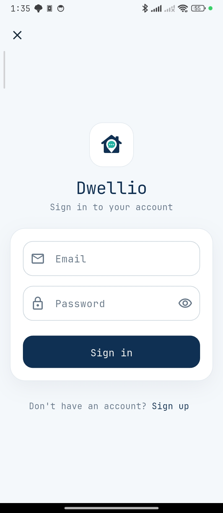
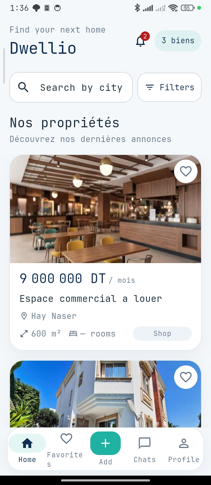
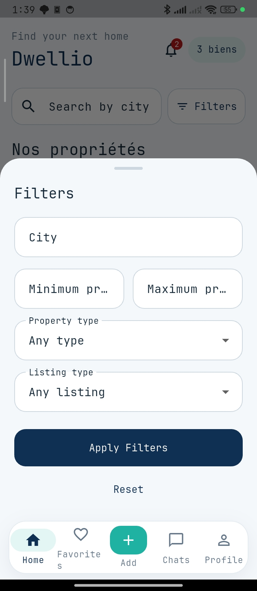
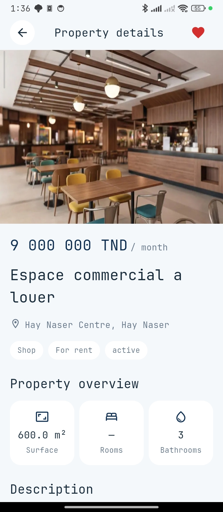
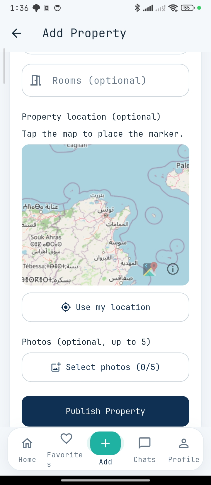
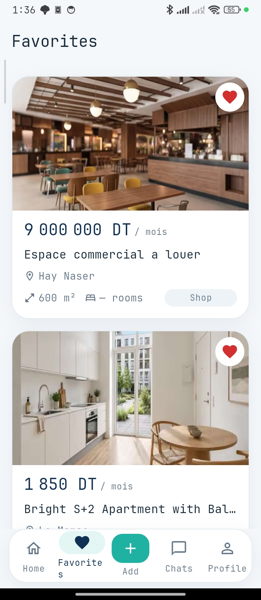
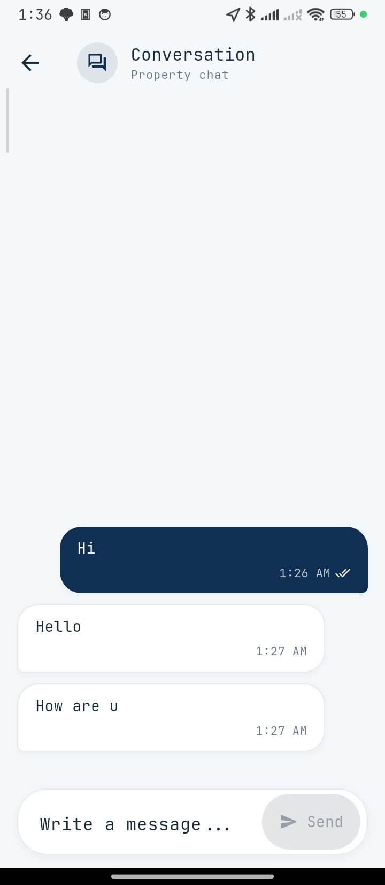
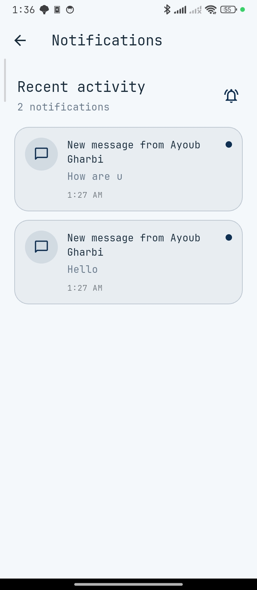
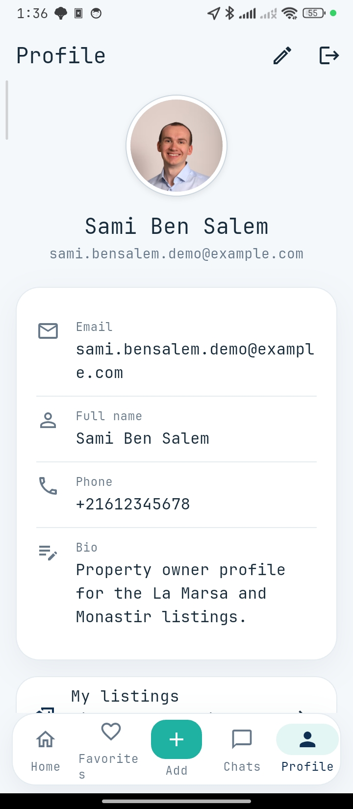

# Real Estate Mobile Services — Flutter App

> A Flutter mobile application for discovering, publishing and managing real-estate listings, with favorites, maps and realtime chat.

The Flutter client is one of two mobile applications in the **Real Estate Mobile Services** project. It uses a shared Supabase backend, so users of the Flutter and React Native applications can browse the same properties, save favorites and communicate with each other.

> **Note:** This README describes the Flutter application's architecture and feature scope from the project roadmap. Update the feature and screenshot sections to reflect the functionality that has actually been merged and verified in the current branch.


---

## Table of Contents

- [Overview](#overview)
- [Features](#features)
- [Screenshots](#screenshots)
- [Tech Stack](#tech-stack)
- [Architecture](#architecture)
- [Project Structure](#project-structure)
- [Routing & Navigation](#routing--navigation)
- [State Management](#state-management)
- [Authentication & Authorization](#authentication--authorization)
- [Backend Integration](#backend-integration)
- [Installation](#installation)
- [Supabase Configuration](#supabase-configuration)
- [Running Locally](#running-locally)
- [Build](#build)
- [Testing](#testing)
- [Performance & Security Considerations](#performance--security-considerations)
- [Roadmap](#roadmap)
- [Contributing](#contributing)
- [License](#license)
- [Team](#team)

---

## Overview

The **Real Estate Mobile Services — Flutter App** is a mobile client that connects property seekers and property owners through one shared Supabase project.

### Implemented Features

- **Property discovery** — browse active listings, search by city with debouncing, and combine filters for location, price, property type and sale/rent.
- **Property details** — view listing information, owner details, property photos and a map marker for the property's coordinates.
- **Property publishing** — submit a sale or rental listing, upload photos to Supabase Storage and choose its location on a map or with the device's current location.
- **Favorites** — save and remove properties with heart toggle, favorite state persisted in Supabase per user.
- **Realtime chat** — contact a property owner, open or reuse a conversation for a property, and exchange messages without refreshing.
- **Account management** — register, log in, log out, retain the authenticated session and edit profile information such as name and phone number.
- **My Listings** — view, edit and delete own property listings.

### Shared-backend model

The Flutter and React Native apps do not communicate directly with each other. Both use the same Supabase project for authentication, database access, file storage and realtime updates. This allows a user on one application to interact with a user on the other.

---

## Features

### Authentication & Profile

| Area | Description |
| --- | --- |
| **Registration** | Create an account with email, password and full name. A database trigger creates the corresponding profile. |
| **Login / Logout** | Authenticate with email and password, sign out and return to the authentication flow. |
| **Session persistence** | Restore the Supabase authentication session when the application is restarted. |
| **Profile** | View and update profile information, including name and phone number. |

### Properties

| Area | Description |
| --- | --- |
| **Home** | Browse active property listings with their main photo, price and city. |
| **Search** | Search properties by city with 400ms debouncing. |
| **Filters** | Combine city, minimum price, maximum price, property type and listing type (sale/rent) in a bottom sheet. |
| **Property details** | View title, price, description, surface, rooms, bathrooms, owner information and property photos. |
| **Photo carousel** | Browse property photos stored in Supabase Storage. |
| **Publish property** | Create a sale or rental listing with validated property information (multi-step form). |
| **Location picker** | Select a point on the map or use the current device location; save latitude and longitude with the listing. |
| **Details map** | Display the saved property coordinates as a marker using OpenStreetMap. |
| **My Listings** | View, edit and delete own property listings. |

### Favorites

- Add or remove a property from Favorites using the heart control on property cards.
- View saved properties in the Favorites tab.
- Keep favorite state synchronized with the database.

### Chat

- Contact the owner from another user's property details.
- Reuse the existing conversation for the same property and buyer instead of creating duplicates.
- View conversations with the other participant's name and property title.
- Load message history and send messages in a chat room.
- Receive new messages in realtime through Supabase Realtime.
- Mark received messages as read.

### Optional / post-MVP features

The roadmap classifies the following as optional and places them after the Must Have features:

- Avatar upload.
- Unread counters on individual chats.
- A separate map displaying all properties.
- Sorting and pagination.
- Remote push notifications while the app is closed.
- Dark mode and multi-language support.

---

## Screenshots

| Screen | Screenshot |
| --- | --- |
| Login |  |
| Home and property cards |  |
| Search and filters |  |
| Property details |  |
| Add property |  |
| Favorites |  |
| Chats |  |
| Notifications |  |
| Profile |  |

---

## Tech Stack

| Layer | Technology | Purpose |
| --- | --- | --- |
| **Framework** | [Flutter](https://flutter.dev/) | Cross-platform mobile application UI and runtime (Android, iOS). |
| **Language** | [Dart](https://dart.dev/) | Application logic, models and services. |
| **State Management** | [flutter_riverpod](https://pub.dev/packages/flutter_riverpod) | Reactive state management for auth, properties, favorites, profile. |
| **Backend SDK** | [supabase_flutter](https://pub.dev/packages/supabase_flutter) | Authentication, PostgreSQL data access, Storage and Realtime. |
| **Navigation** | [go_router](https://pub.dev/packages/go_router) | Declarative navigation with auth redirects and bottom nav preservation. |
| **Maps** | [flutter_map](https://pub.dev/packages/flutter_map) + [latlong2](https://pub.dev/packages/latlong2) | OpenStreetMap-based maps, map markers and location selection. |
| **Geolocation** | [geolocator](https://pub.dev/packages/geolocator) | Location permissions and current device position. |
| **Image selection** | [image_picker](https://pub.dev/packages/image_picker) | Select property photos from the device. |
| **UI** | Material 3 | Modern Material Design components and theming. |

Package versions should be taken from the app's current `pubspec.yaml`. Pin versions after installation and avoid unplanned dependency upgrades during feature work.

---

## Architecture

The Flutter app follows a **Riverpod-based architecture** with clear separation of concerns:

**Screen (UI) → Providers → Services → Supabase Client → Supabase Backend**

- **Screens** display data, collect user input and respond to interactions. They consume providers for state.
- **Providers** (Riverpod) manage reactive state, caching, and coordinate between UI and services.
- **Services** contain data access and application operations (auth, property queries, favorites, chat, profile, location).
- **Models** represent database entities and convert Supabase records into Dart objects.
- **Supabase Client** is the configured SDK instance used by the services.

### Main architectural components

| Component | Responsibility |
| --- | --- |
| **Auth Screens** | Registration and login (`LoginScreen`, `RegisterScreen`). |
| **Property Screens** | Home, search, filters, details, Add/Edit Property, My Listings. |
| **Favorites Screen** | Display saved properties and manage favorite state. |
| **Chat Screens** | Chats list and realtime chat room. |
| **Profile Screen** | View and update profile; log out. |
| **Shell** | `MainShell` with 5-tab bottom navigation (StatefulShellRoute). |
| **Map Components** | Property location display and location picker (`flutter_map`). |
| **AuthService** | Sign up, sign in, sign out and session handling. |
| **ProfileService** | Read and update profile information. |
| **PropertyService** | Fetch, search, filter and publish properties. |
| **FavoriteService** | Add, remove and retrieve favorites. |
| **ChatService** | Get or create conversations and work with messages. |
| **LocationService** | Request location permission and retrieve the device position. |

### Key design decisions

- **Direct Supabase access:** the mobile app uses the Supabase SDK directly; there is no custom API server.
- **Backend-enforced authorization:** PostgreSQL Row Level Security (RLS) protects user-owned and participant-only data.
- **Riverpod for state:** Providers handle auth state, property lists, filters, favorites, and profile data reactively.
- **One shared backend:** Flutter and React Native read and write the same Supabase data.
- **OpenStreetMap in Flutter:** `flutter_map` is used for map display and location selection without requiring a proprietary map API key.

### Application flows

**Authentication**

1. The app initializes Supabase and checks the stored session.
2. An unauthenticated user is directed to Login; an authenticated user enters the main application.
3. Registration creates an Auth user; the database trigger creates the matching `profiles` row.
4. Login uses Supabase email/password authentication.
5. The auth-state listener (Riverpod `authStateProvider`) keeps the app's authentication state synchronized.
6. Logout signs out through Supabase and returns the user to the authentication flow.

**Property publishing**

1. The user completes the property form (multi-step with validation).
2. The user selects photos and chooses a location or uses the current position.
3. The app inserts the property with `owner_id` set to the authenticated user's ID.
4. Photos are uploaded to the `property-images` bucket under the user's/property's folder.
5. The app stores each photo's public URL and storage path in `property_images`.
6. The app opens the newly created property's details after successful publication.

**Messaging**

1. A buyer contacts the owner from a property.
2. The app retrieves the chat for the same `(property_id, buyer_id)` or creates it if it does not exist.
3. The chat screen loads messages ordered by `created_at`.
4. The app subscribes to new message records for that chat via Supabase Realtime.
5. Sending a message inserts one row into `messages`; the realtime stream displays it.
6. A database trigger creates a notification for the other participant and updates `chats.last_message_at`.

---

## Project Structure

```
lib/
├── main.dart                       # App entry point, Supabase init, HomeScreen
├── core/
│   ├── supabase_config.dart        # Supabase URL and anon key configuration
│   ├── theme.dart                  # Material 3 theme, colors, typography
│   ├── router.dart                 # go_router configuration with auth redirects
│   └── validators.dart             # Form validation helpers
├── models/
│   ├── property.dart               # Property, PropertyImage, OwnerProfile, filters
│   ├── chat.dart                   # Chat, Message models
│   └── property_models.dart        # Search results, preview models
├── providers/
│   ├── auth_providers.dart         # Session, auth state, profile providers
│   ├── property_providers.dart     # Property list, filters, details providers
│   ├── profile_providers.dart      # Profile providers
│   └── favorite_providers.dart     # Favorite property IDs provider
├── services/
│   ├── auth_service.dart           # Authentication operations
│   ├── property_service.dart       # Property CRUD, search, filters
│   ├── favorite_service.dart       # Favorites API
│   ├── chat_service.dart           # Chat/messaging operations
│   ├── profile_service.dart        # Profile operations
│   └── location_service.dart       # Geolocation services
├── screens/
│   ├── auth/
│   │   ├── login_screen.dart
│   │   └── register_screen.dart
│   ├── property/
│   │   ├── add_property_screen.dart
│   │   ├── property_details_screen.dart
│   │   ├── property_filter_sheet.dart
│   │   └── my_listings_screen.dart
│   ├── chat/
│   │   ├── chats_screen.dart
│   │   └── chat_screen.dart
│   ├── favorites/
│   │   └── favorites_screen.dart
│   ├── profile/
│   │   └── profile_screen.dart
│   ├── shell/
│   │   └── main_shell.dart         # Bottom navigation shell
│   └── placeholder_screen.dart
├── widgets/
│   ├── property_card.dart          # Reusable property card widget
│   └── auth_form_widgets.dart      # Auth form field components
└── test/                           # Widget and integration tests
```

Keep the actual repository structure authoritative. Update this tree if the implementation uses different filenames or adds folders.

---

## Routing & Navigation

Navigation is handled by **`go_router`** with `StatefulShellRoute.indexedStack` to preserve bottom navigation state, including redirects based on the authentication session.

### Main navigation

The bottom navigation contains five primary destinations (defined in `AppRoutes.tabs`):

| Destination | Route | Purpose |
| --- | --- | --- |
| **Home** | `/home` | Browse, search and filter active properties. |
| **Favorites** | `/favorites` | View saved properties (auth required). |
| **Add** | `/add` | Publish a property (auth required). |
| **Chats** | `/chats` | View existing conversations (auth required). |
| **Profile** | `/profile` | View and update profile, log out (auth required). |

### Secondary routes

- `/property/:id` — Property details
- `/chats/:chatId` — Chat room
- `/profile/my-listings` — My listings (with `/:id/edit` for editing)

### Authentication redirects

- No active session → redirect to `/login` with `from` query parameter for post-login redirect.
- Active session on auth pages → redirect to `from` or `/home`.
- Protected routes (`favorites`, `add`, `chats`, `profile`, `my-listings`) require authentication.
- Logout → clear Supabase session and return to `/login`.

Route constants are defined in `lib/core/router.dart` (`AppRoutes` class).

---

## State Management

The app uses **Flutter Riverpod** (`flutter_riverpod: ^3.5.0`) for reactive state management:

- **`Provider` / `StateNotifierProvider`** — Manage global/shared state (auth session, user profile, favorite property IDs, property filters, property lists).
- **`ConsumerWidget` / `ConsumerStatefulWidget`** — UI components that react to provider changes.
- **`ref.watch` / `ref.read`** — Read provider state in widgets and services.
- **`ref.listen`** — React to state changes (e.g., refresh property list on favorite change, load favorites on login).
- **Services** — Keep Supabase calls out of UI widgets; providers call services.

### Provider overview

| Provider | Purpose |
| --- | --- |
| `sessionProvider` / `authStateProvider` | Current Supabase auth session and user. |
| `profileProvider` | Current user's profile data. |
| `propertyListProvider` | Filtered property list with loading/error states. |
| `propertyFiltersProvider` | Current search filters (city, price range, type, listing type). |
| `favoritePropertyIdsProvider` | Set of favorited property IDs (persisted per user). |
| `homePropertyRefreshProvider` | Trigger to refresh home property list. |
| `routerProvider` | GoRouter instance that reacts to auth changes. |

### Best practices

- Keep Supabase calls inside services, not in widgets.
- Use `ref.listen` for side effects (navigation, showing snackbars, loading related data).
- Dispose of controllers and check `mounted` before `setState` after async work.
- Providers are scoped to the `ProviderScope` at the app root (`main.dart`).

---

## Authentication & Authorization

Authentication is provided by **Supabase Auth** using email and password.

### Session flow

1. Registration calls `signUp` with email, password and the user's full name in metadata.
2. A database trigger creates the matching public `profiles` row.
3. Login uses `signInWithPassword`.
4. The Supabase SDK maintains the session and refreshes authentication tokens.
5. The application listens to auth-state changes and updates navigation accordingly.
6. Logout calls `signOut`.

### Authorization

Authorization is enforced by **PostgreSQL Row Level Security (RLS)**, not only by hiding buttons in the UI.

Examples from the shared backend design:
- Users can update their own profile.
- Property owners can modify their own listings.
- Favorites are scoped to the authenticated user.
- Chats and messages are accessible only to chat participants.
- Storage write access is restricted by the user's folder path and the configured Storage policies.

The application uses the Supabase publishable/anon key. **Never place the Supabase `service_role` key in a mobile application or commit it to the repository.** RLS must remain enabled and correctly configured.

---

## Backend Integration

The Flutter application communicates directly with the shared **Supabase** project through `supabase_flutter`. There is no separate custom REST API server.

### Supabase services

| Supabase component | Usage |
| --- | --- |
| **Auth** | Email/password registration, login, logout and session management. |
| **PostgreSQL** | Application data, relationships, constraints, RLS policies and database triggers. |
| **PostgREST** | Data access through the Supabase SDK. |
| **Storage** | Property photos. |
| **Realtime** | Live message updates in chat. |

### Main database tables

| Table | Purpose |
| --- | --- |
| `profiles` | Public profile information linked to Auth users. |
| `properties` | Sale and rental listings, owner, price, city and coordinates. |
| `property_images` | Property photo URLs, storage paths and carousel order. |
| `favorites` | Saved properties, keyed by user and property. |
| `chats` | One conversation per property and buyer. |
| `messages` | Messages belonging to a conversation. |

Supabase also manages `auth.users` for authentication.

### Storage buckets

- **`property-images`** — property photos, stored under `{user_id}/{property_id}/{unique-name}.jpg`.

The property photo workflow selects images, uploads them to Storage and records their public URLs and storage paths in `property_images`.

### Realtime tables

- `messages` — subscribe to new messages filtered by `chat_id` while a chat is open.

The database triggers handle chat updates; the mobile app reads and displays messages in realtime.

---

## Installation

### Prerequisites

- Flutter SDK installed (3.13+).
- Android Studio / Android SDK, or another configured Android development environment.
- Xcode (for iOS development on macOS).
- An Android emulator, iOS simulator, or physical device with USB debugging enabled.
- Access to the project's Supabase instance.
- Git.

Verify the Flutter environment:

```bash
flutter doctor
```

Resolve any toolchain issues before running the application.

### Clone and install

From the repository root:

```bash
# Clone the project (replace with the repository URL you have access to)
git clone <repository-url>
cd immobilier-services/apps/flutter_app/immobilier

# Install Flutter dependencies
flutter pub get
```

If you already cloned the repository, simply enter the `apps/flutter_app/immobilier` directory and run `flutter pub get`.

---

## Supabase Configuration

The application needs the Supabase project URL and the publishable/anon key.

The configuration is in `lib/core/supabase_config.dart` and Supabase is initialized from `lib/main.dart`.

Example shape (replace the placeholders with the values from your own Supabase project):

```dart
class SupabaseConfig {
  static const String url = 'YOUR_SUPABASE_PROJECT_URL';
  static const String anonKey = 'YOUR_SUPABASE_PUBLISHABLE_OR_ANON_KEY';
}
```

Initialize the client before starting the application:

```dart
await Supabase.initialize(
  url: SupabaseConfig.url,
  anonKey: SupabaseConfig.anonKey,
);
```

Configuration checklist:

- Use the same Supabase project as the React Native application.
- Use the publishable/anon key, never the `service_role` key.
- Ensure the required database tables, RLS policies, triggers, Storage buckets and Realtime publication are configured.
- Keep secrets out of source control. Follow the repository's actual configuration approach if it differs from this example.

The shared SQL scripts and backend setup are maintained at the repository level, outside `apps/flutter_app/`.

---

## Running Locally

From the `apps/flutter_app/immobilier` directory:

```bash
flutter pub get
flutter run
```

To select a connected device:

```bash
flutter devices
flutter run -d <device-id>
```

For a physical device, make sure it can reach the configured Supabase project over the network. The app must use the correct Supabase URL for the environment being tested.

---

## Build

Create a release APK for Android:

```bash
flutter build apk --release
```

Create a release build for iOS (requires macOS with Xcode):

```bash
flutter build ios --release
```

Create a release build for Web:

```bash
flutter build web --release
```

The project includes full iOS configuration in the `ios/` directory.

Before handing over a release build:

- Test installation on a clean device.
- Verify login and session persistence.
- Verify that properties, photos, maps, chat can reach Supabase.
- Confirm the app has the required network and location permissions.

Check `android/app/src/main/AndroidManifest.xml` and `ios/Runner/Info.plist` for required permissions (INTERNET, location).

---

## Testing

The project includes widget and integration tests in the `test/` directory.

### Test files

- `widget_test.dart` — Basic widget tests
- `router_navigation_test.dart` — Navigation and routing tests
- `property_filters_test.dart` — Property filter logic tests
- `property_filter_sheet_test.dart` — Filter sheet UI tests
- `property_location_picker_test.dart` — Location picker tests
- `chats_screen_test.dart` — Chat screen tests
- `chat_screen_test.dart` — Chat room tests
- `my_listings_screen_test.dart` — My listings tests
- `property_edit_form_test.dart` — Property edit form tests
- `property_contact_owner_test.dart` — Contact owner flow tests

### Running tests

```bash
# Run all tests
flutter test

# Run specific test file
flutter test test/widget_test.dart

# Run with coverage
flutter test --coverage
```

### Cross-app integration

At minimum, verify that:

- A Flutter user can publish a property that is visible in React Native, including its photos.
- A React Native user can contact a Flutter listing owner and exchange realtime messages.
- Both applications use the same Supabase data and respect RLS policies.

---

## Performance & Security Considerations

### Performance and lifecycle

- Keep Supabase calls inside services rather than directly inside widget build methods.
- Reuse `Future` and `Stream` instances where appropriate; avoid recreating them on every rebuild.
- Limit property photo selection and reduce their quality according to the publishing workflow.
- Dispose of controllers and manually managed subscriptions when screens are removed.
- Use loading, empty and error states instead of leaving screens blank.
- Use `ListView.builder` for efficient property list rendering.

### Security

- PostgreSQL RLS is the source of truth for access control.
- Never ship the Supabase `service_role` key in the app.
- Use the authenticated user's ID for owner, buyer, favorite and chat operations.
- Keep chat access limited to its buyer and owner.
- Do not rely only on UI visibility or client-side validation to protect database records.
- Display operation errors rather than silently swallowing them.
- Validate all user inputs on both client and server (RLS).

---

## Roadmap

The project roadmap prioritizes the required MVP features first.

### MVP scope (Implemented)

- [x] Email/password authentication and session persistence.
- [x] Profile view and edit (name and phone).
- [x] Property listing, search and filters.
- [x] Property details and photo carousel.
- [x] Publish property with photos and location.
- [x] Favorites toggle and Favorites screen.
- [x] Map on property details, location picker and current location.
- [x] One-to-one realtime chat per property and buyer.
- [x] My Listings (view, edit, delete own properties).
- [x] Android release APK and project documentation.
- [x] Avatar upload.

### Optional / post-MVP scope

- [ ] Unread counters on individual chats.
- [ ] Map screen showing all properties.
- [ ] Sorting and pagination.
- [ ] Remote push notifications.
- [ ] Dark mode.
- [ ] Multi-language support.

These optional features should only be started after the required MVP features are implemented and verified.

---

## Contributing

The repository uses a short-lived feature-branch workflow. The Flutter developer owns the `apps/flutter_app/immobilier/` directory; changes to the shared backend and root documentation are coordinated with the project manager.

1. Start from the latest `main` branch:

   ```bash
   git checkout main
   git pull
   ```

2. Create a feature branch using the repository naming convention:

   ```bash
   git checkout -b flutter/short-feature-name
   ```

3. Keep changes focused on the Flutter application. Do not commit secrets or the Supabase `service_role` key.
4. Run the app on a device or emulator and test the changed feature.
5. Commit using the project's convention, for example:

   ```bash
   git commit -m "feat(flutter): add property location picker"
   ```

6. Push the branch and open a Pull Request into `main`. Include:
   - What changed.
   - How to test it.
   - Screenshots for UI changes.
   - Confirmation that the app runs and no secrets were committed.
7. Address review comments. Merge only after approval, following the repository workflow.

### Commit types

| Type | Usage |
| --- | --- |
| `feat` | New feature. |
| `fix` | Bug fix. |
| `docs` | Documentation. |
| `chore` | Setup, configuration or maintenance. |
| `refactor` | Code cleanup without behavior changes. |
| `test` | Tests. |

---

## License

A license has not been specified in the project roadmap. Add the project's chosen `LICENSE` file before describing the application as distributed under a particular open-source license.

---

## Team

| Member | Responsibility |
| --- | --- |
| **Houssem Aboud** | Flutter application development. |
| **Gharbi Ayoub** | React Native application development. |
| **Zidi Abderrahmen** | Project management, Supabase backend, QA, documentation and C4 diagrams. |

The Flutter application is part of the **Real Estate Mobile Services** university project, developed with a shared Supabase backend and a parallel React Native client.

---
