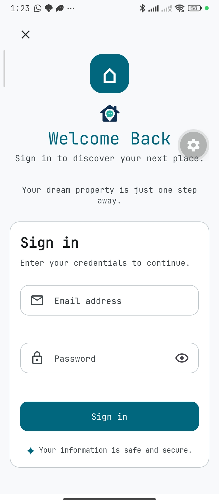
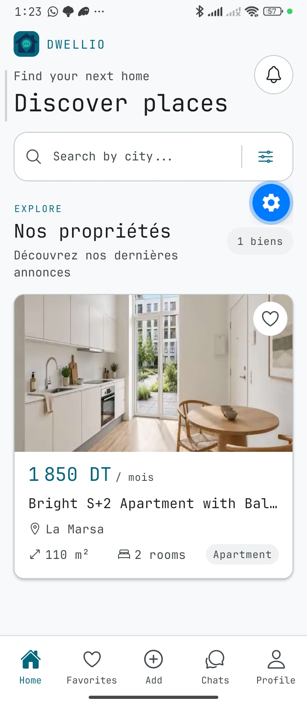
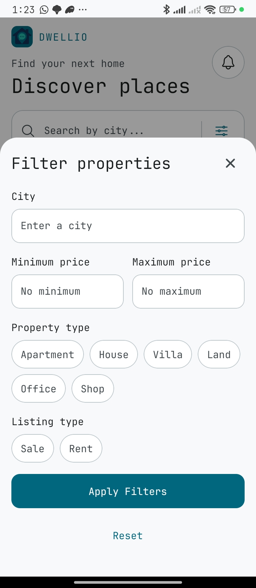
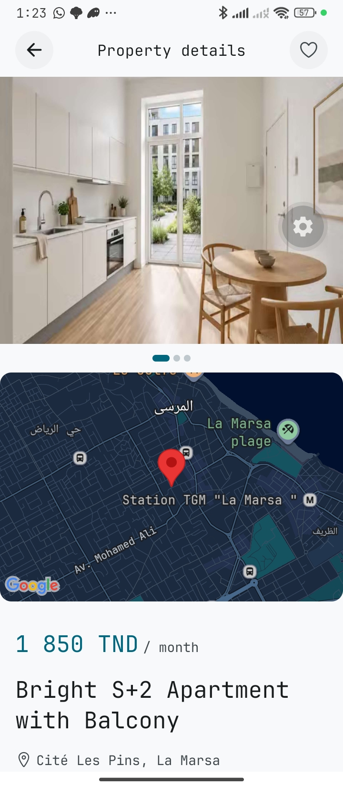
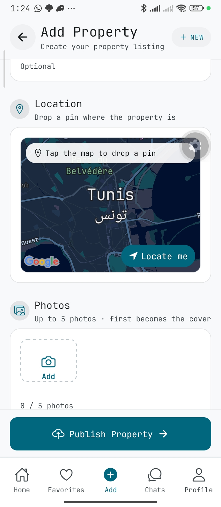
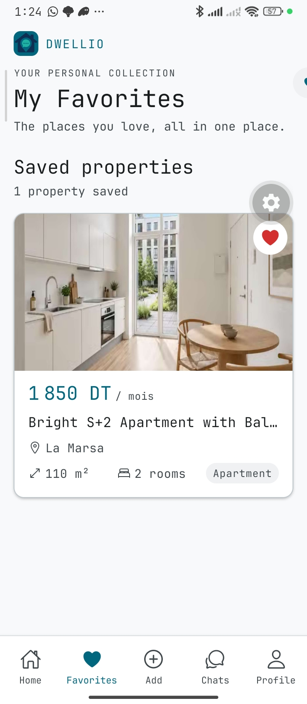
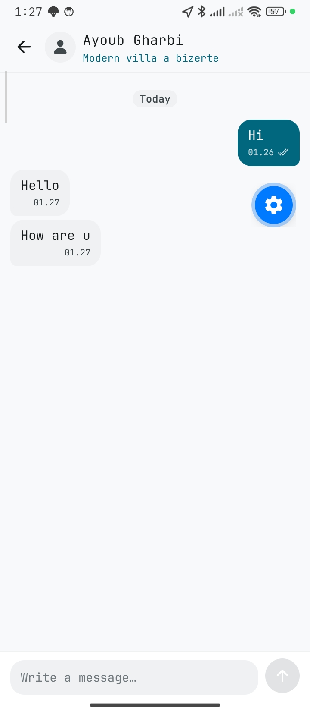
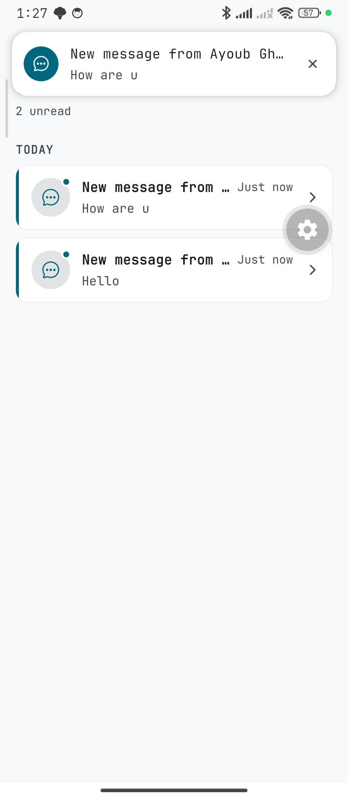
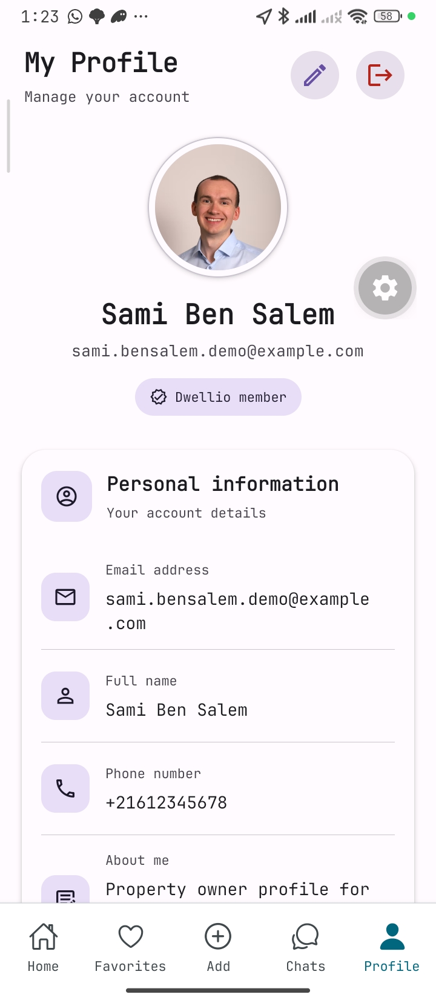

# Real Estate Mobile Services — React Native App

> A React Native mobile application built with Expo and TypeScript for discovering, publishing and managing real-estate listings, with favorites, maps, realtime chat and in-app notifications.

The React Native client is one of two mobile applications in the **Real Estate Mobile Services** project. It shares a single Supabase backend with the Flutter application, allowing users of both apps to browse the same properties, save favorites and communicate with each other.

> **Note:** This README describes the React Native application's planned architecture and feature scope from the project roadmap. Update the feature, project-structure and screenshot sections to reflect the implementation that has actually been merged and verified in the current branch.


---

## Table of Contents

- [Overview](#overview)
- [Features](#features)
- [Screenshots](#screenshots)
- [Tech Stack](#tech-stack)
- [Architecture](#architecture)
- [Project Structure](#project-structure)
- [Routing & Navigation](#routing--navigation)
- [State Management](#state-management)
- [Authentication & Authorization](#authentication--authorization)
- [Backend Integration](#backend-integration)
- [Installation](#installation)
- [Environment Setup](#environment-setup)
- [Running Locally](#running-locally)
- [Build & Deployment](#build--deployment)
- [Testing](#testing)
- [Performance & Security Considerations](#performance--security-considerations)
- [Roadmap](#roadmap)
- [Contributing](#contributing)
- [License](#license)
- [Team](#team)

---

## Overview

The **Real Estate Mobile Services — React Native App** is an Android-first mobile client that connects property seekers and property owners through one shared Supabase project.

### What it is designed to provide

- **Property discovery** — browse active listings, search by title or city, and combine filters for location, price, property type and sale/rent.
- **Property details** — view listing information, owner details, up to five property photos and a map marker for the property's coordinates.
- **Property publishing** — create a sale or rental listing, upload photos to Supabase Storage and choose its location on a map or with the device's current location.
- **Favorites** — save and remove properties, with favorite state persisted in Supabase.
- **Realtime communication** — contact a property owner, open or reuse a conversation for a property, and exchange messages without refreshing.
- **In-app notifications** — receive notifications for new messages and property favorites, view an unread badge and navigate to the related chat or property.
- **Account management** — register, log in, log out, retain the authenticated session and edit profile information such as name and phone number.

### Shared-backend model

The React Native and Flutter apps do not communicate directly with each other. Both use the same Supabase project for authentication, database access, file storage and realtime updates. This allows a user on one application to interact with a user on the other.

---

## Features

### Authentication & Profile

| Area | Description |
| --- | --- |
| **Registration** | Create an account with email, password and full name. A database trigger creates the corresponding profile. |
| **Login / Logout** | Authenticate with email and password, sign out and return to the authentication flow. |
| **Session persistence** | Persist the Supabase session using AsyncStorage and restore it when the app restarts. |
| **Profile** | View and update profile information, including name and phone number. |

### Properties

| Area | Description |
| --- | --- |
| **Home** | Browse active property listings with their main photo, price and city. |
| **Search** | Search property titles and cities. |
| **Filters** | Combine city, minimum price, maximum price, property type and listing type (sale/rent). |
| **Property details** | View title, price, description, surface, rooms, owner information and property photos. |
| **Photo carousel** | Browse up to five photos stored in Supabase Storage. |
| **Publish property** | Create a sale or rental listing with validated property information. |
| **Location picker** | Select a point on the map or use the current device location; save latitude and longitude with the listing. |
| **Details map** | Display the saved property coordinates as a map marker. |

### Favorites

- Add or remove a property from Favorites using the heart control.
- View saved properties in the Favorites tab.
- Keep favorite state synchronized with the database.
- Notify the property owner when another user favorites their listing.

### Chat & Notifications

- Contact the owner from another user's property details.
- Reuse the existing conversation for the same property and buyer instead of creating duplicates.
- View conversations with the other participant's name and property title.
- Load message history and send messages in a chat room.
- Receive new messages in realtime through Supabase.
- Mark received messages as read.
- Receive in-app notifications for new messages and new favorites.
- Display an unread notification badge and an in-app banner.
- Open the relevant chat or property by tapping a notification.

### Optional / post-MVP features

The roadmap classifies the following as optional and places them after the Must Have features:

- Avatar upload.
- Unread counters on individual chats.
- A separate map displaying all properties.
- Sorting and pagination.
- Remote push notifications while the app is closed.
- Dark mode and multi-language support.

---

## Screenshots

| Screen | Screenshot |
| --- | --- |
| Login |  |
| Home and property cards |  |
| Search and filters |  |
| Property details |  |
| Add property |  |
| Favorites |  |
| Chats |  |
| Notifications |  |
| Profile |  |

---

## Tech Stack

| Layer | Technology | Purpose |
| --- | --- | --- |
| **Framework** | [React Native](https://reactnative.dev/) | Cross-platform mobile application UI and runtime. |
| **Development platform** | [Expo](https://expo.dev/) | App development, Expo SDK modules and development workflow. |
| **Language** | [TypeScript](https://www.typescriptlang.org/) | Application logic, models and service types. |
| **Navigation** | [Expo Router](https://docs.expo.dev/router/introduction/) | File-based routing, route groups and tab navigation. |
| **Backend SDK** | [Supabase JavaScript Client](https://supabase.com/docs/reference/javascript/introduction) | Authentication, PostgreSQL data access, Storage and Realtime. |
| **Session storage** | [AsyncStorage](https://react-native-async-storage.github.io/async-storage/) | Persist the Supabase authentication session on the device. |
| **URL compatibility** | [react-native-url-polyfill](https://www.npmjs.com/package/react-native-url-polyfill) | URL API compatibility required by the Supabase client in React Native. |
| **Image selection** | [expo-image-picker](https://docs.expo.dev/versions/latest/sdk/imagepicker/) | Select property photos from the device. |
| **Image upload encoding** | [base64-arraybuffer](https://www.npmjs.com/package/base64-arraybuffer) | Decode selected image data for Supabase Storage upload. |
| **Image display** | [expo-image](https://docs.expo.dev/versions/latest/sdk/image/) | Display remote property images. |
| **Maps** | [react-native-maps](https://docs.expo.dev/versions/latest/sdk/map-view/) | Display property maps and markers, and allow location selection. |
| **UI components** | [react-native-paper](https://reactnativepaper.com/) | Snackbar and material UI components used by the app. |
| **Image manipulation** | [expo-image-manipulator](https://docs.expo.dev/versions/latest/sdk/imagemanipulator/) | Resize/compress selected property photos before upload. |
| **Geolocation** | [expo-location](https://docs.expo.dev/versions/latest/sdk/location/) | Request foreground location permission and retrieve the current position. |
| **Optional local notifications** | [expo-notifications](https://docs.expo.dev/versions/latest/sdk/notifications/) | Optional local notification functionality; not required for the MVP. |

Use `npx expo install` for Expo SDK packages so their versions match the Expo SDK used by the project. Keep dependency versions aligned with the current `package.json` and lockfile; avoid unplanned dependency upgrades during feature work.

---

## Architecture

The React Native app follows a lightweight **three-layer architecture**:

**Screen (UI) → Service → Supabase Client → Supabase Backend**

- **Screens and components** display data, collect user input and respond to interactions. They should not contain direct Supabase queries.
- **Services** contain data access and application operations, such as authentication, property queries, favorites, chat, notifications, storage and location.
- **Types/models** represent database entities and describe the records exchanged with Supabase.
- **Supabase Client** is the configured SDK instance used by the services.
- **AuthContext** shares the authenticated session with the application and supports authentication-aware navigation.

### Main architectural components

| Component | Responsibility |
| --- | --- |
| **Auth Screens** | Registration and login. |
| **Property Screens** | Home, search, filters, details and Add Property. |
| **Favorites Screen** | Display saved properties and manage favorite state. |
| **Chat Screens** | Chats list and realtime chat room. |
| **Notification Screen** | Notification history, unread state and notification navigation. |
| **Profile Screen** | View and update profile; log out. |
| **Map Components** | Display property coordinates and choose a location. |
| **AuthService** | Sign up, sign in, sign out and session handling. |
| **ProfileService** | Read and update profile information. |
| **PropertyService** | Fetch, search, filter and publish properties. |
| **FavoriteService** | Add, remove and retrieve favorites. |
| **ChatService** | Get or create conversations and work with messages. |
| **NotificationService** | Read notifications, mark them as read and manage notification updates. |
| **StorageService** | Upload and retrieve property photos and avatars. |
| **LocationService** | Request location permission and retrieve the device position. |

### Key design decisions

- **Direct Supabase access:** the mobile app uses the Supabase SDK directly; there is no custom API server in the MVP.
- **Backend-enforced authorization:** PostgreSQL Row Level Security (RLS) protects user-owned and participant-only data.
- **Database-generated notifications:** triggers create `new_message` and `favorite_added` notifications so both mobile clients share the same behavior.
- **One shared backend:** React Native and Flutter read and write the same Supabase data.
- **Lightweight state management:** React hooks manage local state; one `AuthContext` shares authentication state. No additional global state library is required by the roadmap.
- **Expo-compatible dependencies:** Expo modules are installed using `npx expo install` to match the project's Expo SDK.

### Application flows

**Authentication**

1. The app initializes the Supabase client with the project URL, anon/publishable key and AsyncStorage session persistence.
2. The app checks the stored session. An unauthenticated user is directed to Login; an authenticated user enters the main application.
3. Registration calls `signUp` with email, password and the user's full name in metadata.
4. A database trigger creates the matching `profiles` row.
5. Login uses `signInWithPassword`; the auth-state listener updates the application session.
6. Logout calls `signOut` and returns the user to the authentication flow.

**Property publishing**

1. The user completes the property form.
2. The user selects up to five photos using Expo Image Picker and chooses a location or uses the current position.
3. The app inserts the property with `owner_id` set to the authenticated user's ID and receives the new property ID.
4. Selected image data is decoded and uploaded to the `property-images` bucket under the user's/property's folder.
5. The app stores each photo's public URL and storage path in `property_images`.
6. The app opens the newly created property's details after successful publication.

**Messaging**

1. A buyer contacts the owner from a property.
2. The app retrieves the chat for the same `(property_id, buyer_id)` or creates it if it does not exist.
3. The chat screen loads message history ordered by `created_at`.
4. The app subscribes to new message INSERT events filtered by `chat_id`.
5. Sending a message inserts one row into `messages`; the Realtime event updates the message list.
6. A database trigger creates a notification for the other participant and updates `chats.last_message_at`.
7. The Realtime channel is removed when leaving the chat screen or changing the chat.

**Notifications**

1. A database trigger creates a notification after a new message or favorite.
2. The app subscribes to notifications filtered by the authenticated user's ID.
3. The unread badge and in-app banner update when a new notification arrives.
4. Tapping a notification opens its related chat or property and marks it as read.

---

## Project Structure

The roadmap defines the following React Native / Expo organization. The exact files may evolve as features are implemented:

```text
apps/react_native_app/immobilier/
├── src/
│   ├── app/                         # Expo Router routes and layouts
│   │   ├── (auth)/                  # Login and Register routes
│   │   ├── (tabs)/                  # Home, Favorites, Add, Chats and Profile tabs
│   │   ├── property/                # Property details and related routes
│   │   ├── chat/                    # Chat room route(s)
│   │   ├── explore.tsx              # Explore screen
│   │   ├── my-listings.tsx          # Owner's listings (edit/delete)
│   │   └── notifications.tsx        # Notifications screen
│   ├── lib/
│   │   └── supabase.ts              # Supabase client configuration
│   ├── services/                    # Auth, profile, property, favorite, chat, etc.
│   ├── types/                       # TypeScript types for database records
│   ├── context/
│   │   └── AuthContext.tsx          # Shared authentication state
│   └── components/                  # Reusable UI components
├── assets/                          # App icons and static assets
├── app.json                         # Expo application configuration
├── package.json
├── package-lock.json
└── tsconfig.json
```

Keep the actual repository structure authoritative. Update this tree if the implementation uses different filenames or adds folders.

---

## Routing & Navigation

Navigation uses **Expo Router**, with file-based routes and route groups for authentication and the main application.

### Main navigation

The bottom tab navigation contains five primary destinations:

| Destination | Purpose |
| --- | --- |
| **Home** | Browse, search and filter active properties. |
| **Favorites** | View saved properties. |
| **Add** | Publish a property. |
| **Chats** | View existing conversations. |
| **Profile** | View and update the current profile, and log out. |

Property details, filters, the chat room, Notifications screen and map/location picker are opened as secondary routes. A notification bell with an unread badge is available in the Home header.

### Authentication redirects

- No active session → show the authentication screens in the `(auth)` route group.
- Active session → allow access to the main application in the `(tabs)` route group.
- Logout → clear the Supabase session and return to Login.

The exact route paths should follow the current files in `app/`. Example route patterns from the roadmap include `app/(auth)/login.tsx`, `app/(tabs)/index.tsx`, `app/property/[id].tsx` and `app/chat/[id].tsx`.

---

## State Management

The roadmap deliberately avoids a large state-management framework.

- **`useState`** handles local component and screen state.
- **`useEffect`** loads data and manages subscriptions or other lifecycle-dependent work.
- **`AuthContext`** shares the authenticated session and user information across the app.
- **Services** keep Supabase calls out of UI components.
- **Realtime subscriptions** update chat messages and notifications when database events arrive.

For Supabase Realtime:
- Subscribe only to the relevant table and filter (`chat_id` for messages, `user_id` for notifications).
- Prevent duplicate records when applying INSERT events to local state.
- Remove subscriptions with `supabase.removeChannel(...)` when the relevant screen or authenticated scope is disposed.
- Avoid creating new subscriptions on every render.

The project does not require Redux, Zustand or another global state library. Keep the implementation simple and consistent with the existing hooks and context.

---

## Authentication & Authorization

Authentication is provided by **Supabase Auth** using email and password.

### Session flow

1. The Supabase client is configured with `AsyncStorage`, `autoRefreshToken: true`, `persistSession: true` and `detectSessionInUrl: false`.
2. Registration calls `supabase.auth.signUp(...)` and includes `full_name` in user metadata.
3. A database trigger creates the corresponding row in `profiles`.
4. Login calls `signInWithPassword(...)`.
5. `AuthContext` reads the current session and listens to `onAuthStateChange` to keep the UI synchronized.
6. Logout calls `signOut()` and redirects to Login.

### Authorization

Authorization is enforced by **PostgreSQL Row Level Security (RLS)**, not only by hiding buttons in the UI.

Examples from the shared backend design:
- Users can update their own profile.
- Property owners can modify their own listings.
- Favorites are scoped to the authenticated user.
- Chats and messages are accessible only to chat participants.
- Notifications are readable and updatable only by their recipient.
- Storage write access is restricted by the user's folder path and the configured Storage policies.

The application uses the Supabase anon/publishable client key. **Never place the Supabase `service_role` key in a mobile application or commit it to the repository.** RLS must remain enabled and correctly configured.

---

## Backend Integration

The React Native application communicates directly with the shared **Supabase** project through `@supabase/supabase-js`. There is no separate custom REST API server in the MVP.

### Supabase services

| Supabase component | Usage |
| --- | --- |
| **Auth** | Email/password registration, login, logout and session management. |
| **PostgreSQL** | Application data, relationships, constraints, RLS policies and database triggers. |
| **PostgREST** | Data access through the Supabase client. |
| **Storage** | Property photos and, optionally, profile avatars. |
| **Realtime** | Live message and notification updates. |

### Main database tables

| Table | Purpose |
| --- | --- |
| `profiles` | Public profile information linked to Auth users. |
| `properties` | Sale and rental listings, owner, price, city and coordinates. |
| `property_images` | Property photo URLs, storage paths and carousel order. |
| `favorites` | Saved properties, keyed by user and property. |
| `chats` | One conversation per property and buyer. |
| `messages` | Messages belonging to a conversation. |
| `notifications` | In-app notifications for messages and favorites. |

Supabase also manages `auth.users` for authentication.

### Storage buckets

- **`property-images`** — property photos, stored under `{user_id}/{property_id}/{unique-name}.jpg`.
- **`avatars`** — reserved for profile avatars, an optional feature in the roadmap.

The planned property photo workflow selects up to five images at reduced quality (approximately 60%), requests base64 data from Expo Image Picker, decodes it with `base64-arraybuffer`, uploads it to Storage and records its public URL and storage path in `property_images`.

### Realtime tables

- `messages` — subscribe to new messages filtered by `chat_id` while a chat is open.
- `notifications` — subscribe to notifications filtered by the authenticated `user_id`.

The database triggers generate notifications; the mobile app reads and displays them. Remote push notifications while the app is closed are outside the MVP scope.

---

## Installation

### Prerequisites

- Node.js version supported by the Expo SDK used in this project.
- npm (or the package manager and lockfile already used by the repository).
- Android Studio / Android SDK and an Android emulator, or a physical Android device.
- [Expo Go](https://expo.dev/go) on a compatible physical device for the Expo Go development workflow.
- Access to the project's Supabase instance.
- Git.

### Clone and install

From the repository root:

```bash
# Clone the project (replace with the repository URL you have access to)
git clone <repository-url>
cd immobilier-services/apps/react_native_app/immobilier

# Install dependencies
npm install
```

If you already cloned the repository, enter the `apps/react_native_app/immobilier` directory and install dependencies there.

---

## Environment Setup

The application reads its Supabase configuration from Expo public environment variables. The roadmap's client configuration uses:

- `EXPO_PUBLIC_SUPABASE_URL`
- `EXPO_PUBLIC_SUPABASE_ANON_KEY`

Create a `.env` file in the `apps/react_native_app/immobilier/` directory:

```dotenv
EXPO_PUBLIC_SUPABASE_URL=https://YOUR_PROJECT_REF.supabase.co
EXPO_PUBLIC_SUPABASE_ANON_KEY=YOUR_SUPABASE_ANON_OR_PUBLISHABLE_KEY
```

The Supabase client in `src/lib/supabase.ts` should use these values and configure session persistence with AsyncStorage. The roadmap's configuration pattern is:

```ts
import 'react-native-url-polyfill/auto';
import AsyncStorage from '@react-native-async-storage/async-storage';
import { createClient } from '@supabase/supabase-js';

export const supabase = createClient(
  process.env.EXPO_PUBLIC_SUPABASE_URL!,
  process.env.EXPO_PUBLIC_SUPABASE_ANON_KEY!,
  {
    auth: {
      storage: AsyncStorage,
      autoRefreshToken: true,
      persistSession: true,
      detectSessionInUrl: false,
    },
  }
);
```

Configuration checklist:

- Use the same Supabase project as the Flutter application.
- Use only the anon/publishable client key; never use the `service_role` key in the app.
- Do not commit `.env` if it contains project configuration that the team keeps outside source control. Add it to `.gitignore` and provide a safe `.env.example` with placeholder values if the repository uses that convention.
- Ensure the required database tables, RLS policies, triggers, Storage buckets and Realtime publication are configured.
- Expo public variables are bundled into the client application; they are not a place for private server secrets. Protect data with RLS.

The shared SQL scripts and backend setup are maintained at the repository level, outside `apps/react_native_app/immobilier/`.

---

## Running Locally

From the `apps/react_native_app/immobilier/` directory:

```bash
npm install
npx expo start
```

Then:
- Open the project in Expo Go by scanning the development QR code, or
- Start the Android emulator workflow from the Expo CLI if the Android development environment is configured.

For example:

```bash
npx expo start --android
```

Make sure the device or emulator can reach the configured Supabase project. A physical device must use a reachable Supabase URL; do not use `localhost` to refer to a service running on the development computer from a separate phone.

If Expo configuration or environment values have changed and the bundler is using stale cached data, restart with:

```bash
npx expo start -c
```

---

## Build & Deployment

### Android build

The project roadmap prefers an Android APK created with **EAS Build** when the Expo account and build queue allow it. A `preview` build profile can be used for an installable demonstration build:

```bash
eas build --platform android --profile preview
```

This command assumes that EAS is configured for the project and that the required build profile exists in `eas.json`. If it has not been configured, add the EAS project/build configuration before running the command.

### Expo Go fallback

If an Android APK cannot be produced in time, the roadmap allows a stable **Expo Go** demonstration. Document the exact steps and SDK compatibility needed to run the app on the demonstration device.

### Delivery scope

- Android is the target platform for the project delivery.
- iOS is not part of the planned delivery scope.
- Publishing the application to Google Play or another app store is not planned.
- Remote push notifications are post-MVP; the required notification experience is in-app and realtime.

Before handing over a build or demo:
- Test login and session persistence.
- Verify that properties and photos load from Supabase.
- Verify location permission and map behavior.
- Verify cross-app chat and notifications.
- Confirm that the app uses the correct Supabase project configuration.

---

## Testing

The project testing plan requires functional testing on **both** mobile applications. Record the React Native result and Flutter result separately in the repository-level `docs/test-report.md`.

### Functional test coverage

| ID | Feature | Expected result |
| --- | --- | --- |
| F-01–F-07 | Authentication and profile | Register, login, session persistence, logout and profile edits work. |
| F-08–F-13 | Property browsing | Home, search, filters, details and photo carousel display correct data. |
| F-14–F-16 | Publish property | Valid listing is created; invalid form is blocked; publishing without photos is handled. |
| F-17 | Favorites | Add/remove and Favorites list remain consistent. |
| F-18–F-19 | Maps and location picker | Details marker is correct and selected coordinates are saved. |
| F-20 | Contact owner | Chat opens for another user's property; own listing hides the action. |
| F-21 | Messaging | Messages appear in order without duplicates. |
| F-22–F-23 | Notifications | Recipient gets a notification; tapping it opens the correct destination and marks it read. |
| F-24 | Offline behavior | Network failures show an error without crashing the app. |

### Cross-app integration

At minimum, verify that:

- A React Native user can publish a property that is visible in Flutter, including its photos.
- A Flutter user can contact a React Native listing owner and exchange realtime messages.
- The receiving application gets the corresponding in-app notification.
- Both applications use the same Supabase data and respect RLS policies.

### Reporting

For each test, record:
- Test ID and scenario.
- React Native result.
- Flutter result.
- Actual behavior and evidence.
- Related bug issue, if any.

A feature is `DONE` when its developer reports it finished. It is `VERIFIED` only after it has been tested on a device.

---

## Performance & Security Considerations

### Performance and lifecycle

- Keep Supabase calls inside services rather than directly inside UI components.
- Use `useEffect` to manage data loading and subscriptions; keep effect dependencies correct.
- Remove Realtime channels with `supabase.removeChannel(...)` when their relevant screen or authenticated scope is disposed.
- Prevent duplicate messages and notifications by checking record IDs before updating local state.
- Limit property photo selection to five images and reduce their quality according to the publishing workflow.
- Use `expo-image` for remote property photos.
- Provide loading, empty and error states instead of leaving screens blank.
- Avoid adding a new state-management library when hooks and `AuthContext` are sufficient.

### Security

- PostgreSQL RLS is the source of truth for access control.
- Never ship the Supabase `service_role` key in the app.
- Use the authenticated user's ID for owner, buyer, favorite and notification operations.
- Keep chat access limited to its buyer and owner.
- Keep notifications private to their recipient.
- Do not rely only on UI visibility or client-side validation to protect database records.
- Expo `EXPO_PUBLIC_` environment variables are public client configuration, not secret storage.
- Display operation errors rather than silently swallowing them.

---

## Roadmap

The project roadmap prioritizes the required MVP features first.

### MVP scope

- [x] Email/password authentication and session persistence.
- [x] Profile view and edit (name and phone).
- [x] Property listing, search and filters.
- [x] Property details and photo carousel.
- [x] Publish property with photos and location.
- [x] Favorites toggle and Favorites screen.
- [x] Map on property details, location picker and current location.
- [x] One-to-one realtime chat per property and buyer.
- [x] In-app notifications with realtime unread badge.
- [x] Android build or documented Expo Go demonstration, plus project documentation.
- [x] Avatar upload.

### Optional / post-MVP scope

- [ ] Unread counters on individual chats.
- [ ] Map screen showing all properties.
- [ ] Sorting and pagination.
- [ ] Remote push notifications.
- [ ] Dark mode.
- [ ] Multi-language support.

These optional features should only be started after the required MVP features are implemented and verified.

---

## Contributing

The repository uses a short-lived feature-branch workflow. The React Native developer owns the `apps/react_native_app/immobilier/` directory; changes to the shared backend and root documentation are coordinated with the project manager.

1. Start from the latest `main` branch:

   ```bash
   git checkout main
   git pull
   ```

2. Create a feature branch using the repository naming convention:

   ```bash
   git checkout -b rn/short-feature-name
   ```

3. Keep changes focused on the React Native application. Do not commit `.env`, private credentials or the Supabase `service_role` key.
4. Use `npx expo install` for Expo SDK packages and avoid unnecessary dependency upgrades.
5. Run the app on an Android device, emulator or the project's chosen Expo Go workflow and test the changed feature.
6. Commit using the project's convention, for example:

   ```bash
   git commit -m "feat(rn): add property location picker"
   ```

7. Push the branch and open a Pull Request into `main`. Include:
   - What changed.
   - How to test it.
   - Screenshots for UI changes.
   - Confirmation that the app runs and no secrets were committed.
8. Address review comments. Merge only after approval, following the repository workflow.

### Commit types

| Type | Usage |
| --- | --- |
| `feat` | New feature. |
| `fix` | Bug fix. |
| `docs` | Documentation. |
| `chore` | Setup, configuration or maintenance. |
| `refactor` | Code cleanup without behavior changes. |
| `test` | Tests. |

---

## License

A license has not been specified in the project roadmap. Add the project's chosen `LICENSE` file before describing the application as distributed under a particular open-source license.

---

## Team

| Member | Responsibility |
| --- | --- |
| **Houssem Aboud** | Flutter application development. |
| **Gharbi Ayoub** | React Native application development. |
| **Zidi Abderrahmen** | Project management, Supabase backend, QA, documentation and C4 diagrams. |

The React Native application is part of the **Real Estate Mobile Services** university project, developed with a shared Supabase backend and a parallel Flutter client.

---
