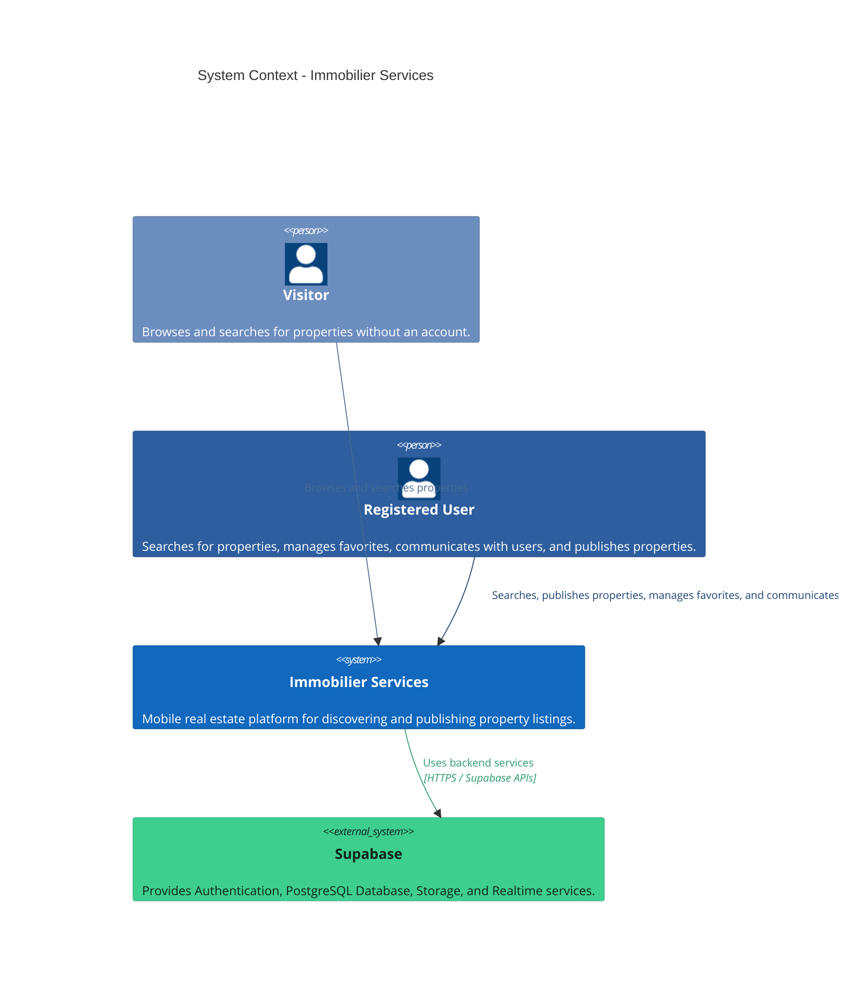

# C4 Level 1 — System Context Diagram

## 1. Purpose

This diagram provides a high-level overview of the
Immobilier Services platform, its users, and its
external dependencies.

It identifies who interacts with the system and
the main relationships between them.

## 2. System Description

Immobilier Services is a mobile real estate platform
that allows users to discover, publish, and manage
real estate listings.

Registered users can both search for properties
and publish their own properties using the same account.

## 3. Actors and External Systems

| Element | Type | Description |
|---|---|---|
| Visitor | Person | Browses and searches for properties without authentication. |
| Registered User | Person | Searches, manages favorites, communicates with other users, and publishes properties. |
| Supabase | External Software System | Provides authentication, database, file storage, and realtime services. |

## 4. System Context Diagram

## 5. Architecture Decisions

- A registered user can act as both a property
  seeker and a property owner using one account.
- Property Owner is not a separate account type
  or actor in this context diagram.
- Administrator functionality is outside the
  current project scope.
- Supabase is an external system, not part of
  the application's internal implementation.

## 6. Scope

This diagram represents the system at a high level.
Mobile applications, internal components, and
database structures will be detailed in subsequent
C4 diagrams.