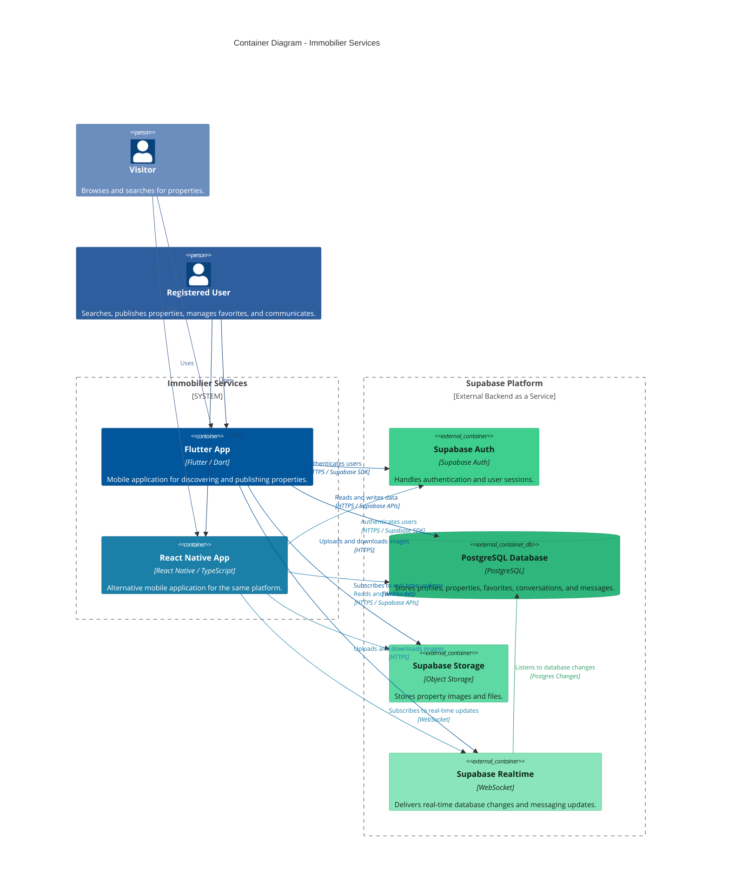

# C4 Level 2 — Container Diagram

## 1. Purpose

This diagram describes the high-level technical
architecture of the Immobilier Services platform.

It shows the mobile applications, external backend
services, databases, and the relationships between them.

## 2. Containers

| Container | Technology | Responsibility |
|---|---|---|
| Flutter App | Flutter / Dart | Mobile application developed with Flutter. |
| React Native App | React Native / TypeScript | Mobile application developed with React Native. |
| Supabase Auth | Supabase Auth | User authentication and session management. |
| PostgreSQL Database | PostgreSQL | Stores application data. |
| Supabase Storage | Supabase Storage | Stores property images and files. |
| Supabase Realtime | Supabase Realtime | Provides real-time communication and updates. |

## 3. Container Diagram

## 4. Important Architecture Decisions

- Both mobile applications use the same Supabase backend.
- There is no separate custom backend server in the current architecture.
- Both applications access application data through Supabase APIs.
- PostgreSQL is the central source of application data.
- Supabase Storage is responsible for storing property images.
- Supabase Realtime enables live messaging updates.
- Row Level Security (RLS) protects database access.
- Authentication is handled by Supabase Auth.

## 5. Security

The mobile applications use the Supabase client libraries
to communicate with the backend services.

Database access must be protected using Row Level Security
(RLS) policies.

The Supabase service_role key must never be exposed
inside mobile applications.

## 6. Scope

This diagram focuses on the main application containers
and external backend services.

Internal application components will be described
in the C4 Level 3 Component Diagram.