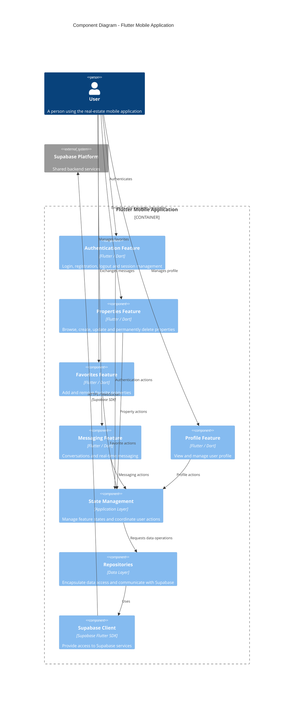
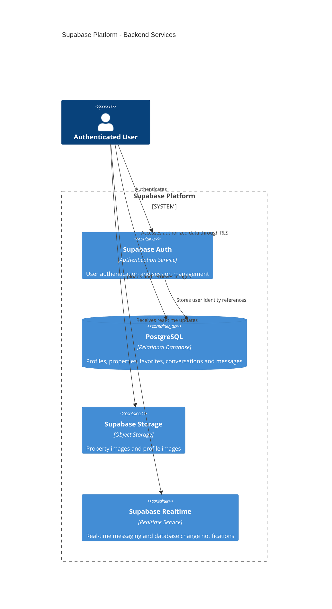
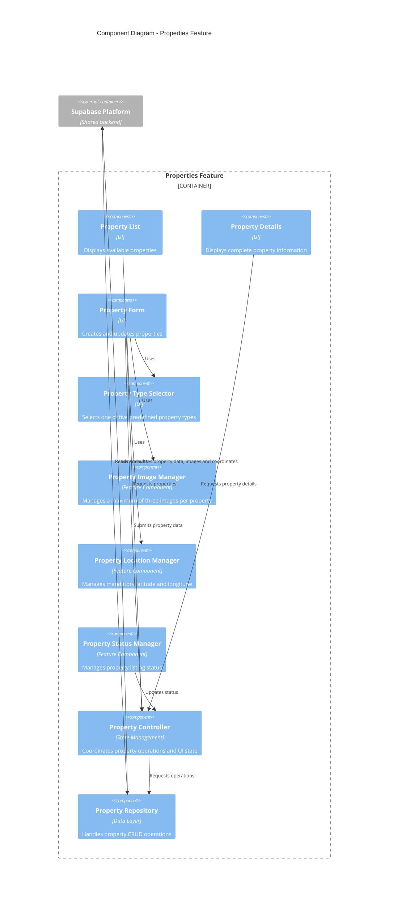

# C4 Model — Level 3: Component Diagram

**Project:** Immobilier Services  
**Container:** Flutter Mobile Application  
**Version:** 1.0  
**Date:** 03 November 2026

## 1. Flutter Application — Component Diagram

## 2. Supabase Backend — External Services

The Flutter application communicates with the following Supabase services:

## 3. Property Feature — Component Diagram

## 4. Property Business Rules

| Rule | Decision |
|---|---|
| Property types | Fixed list of 5 types |
| Listing types | Sale / Rent |
| Maximum images | 3 per property |
| Geographic location | Mandatory |
| Coordinates | Latitude and longitude required together |
| Property deletion | Permanent Delete |
| Data access | Supabase Row Level Security |

## 5. Architecture Notes

- Both Flutter and React Native applications use the same Supabase backend.
- Each application implements its own UI and state management.
- The five application features are Authentication, Properties, Favorites, Messaging and Profile.
- Repositories isolate data access from UI components.
- Supabase provides authentication, PostgreSQL, storage and real-time capabilities.
- Row Level Security enforces database authorization.