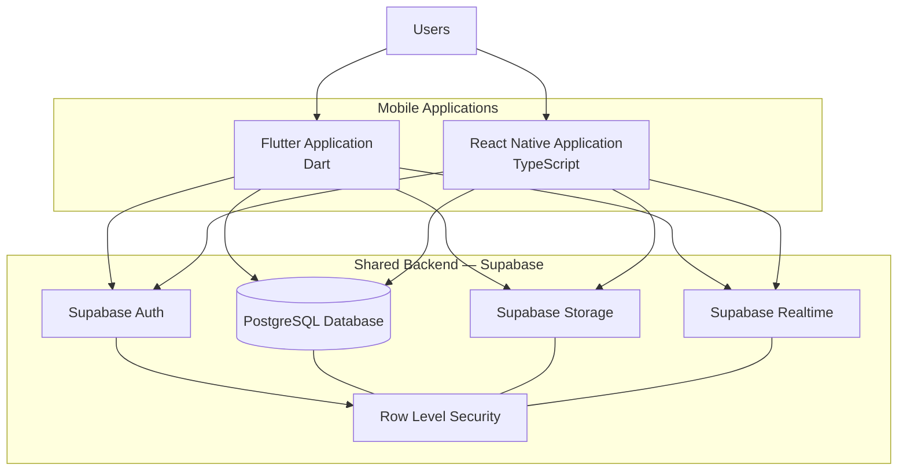
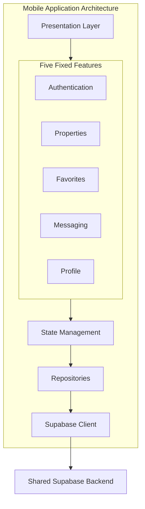
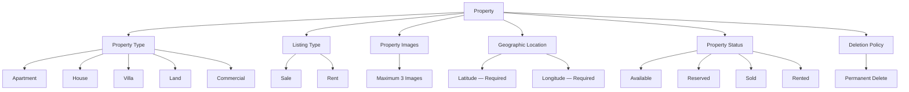
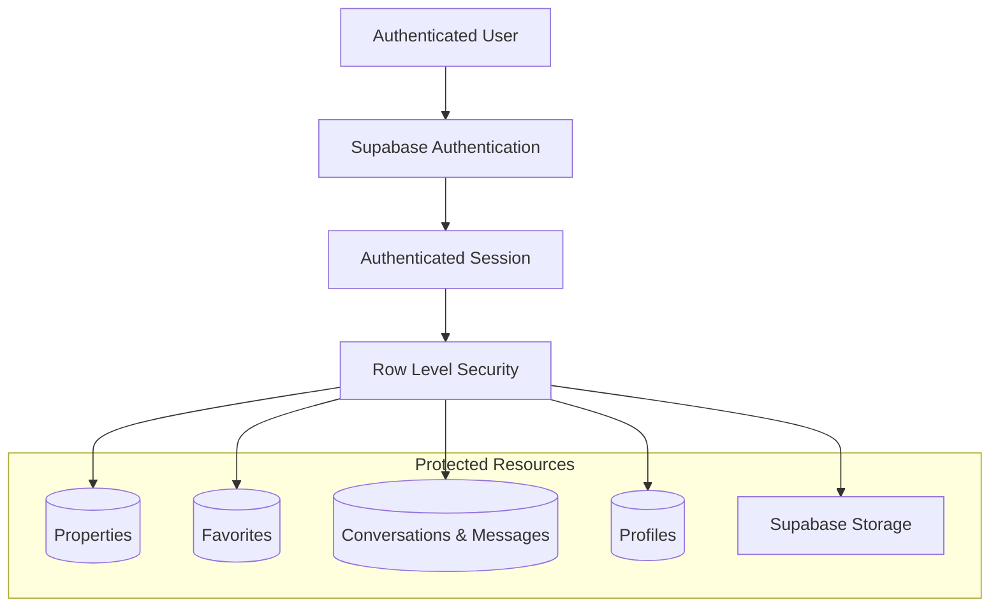
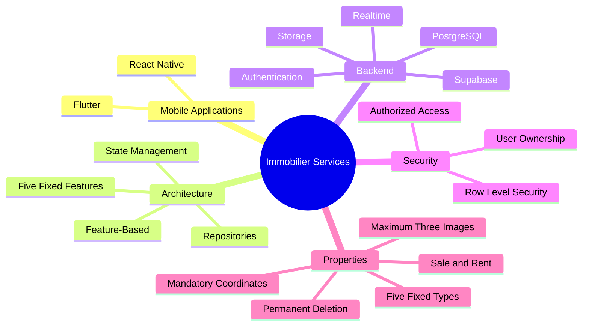
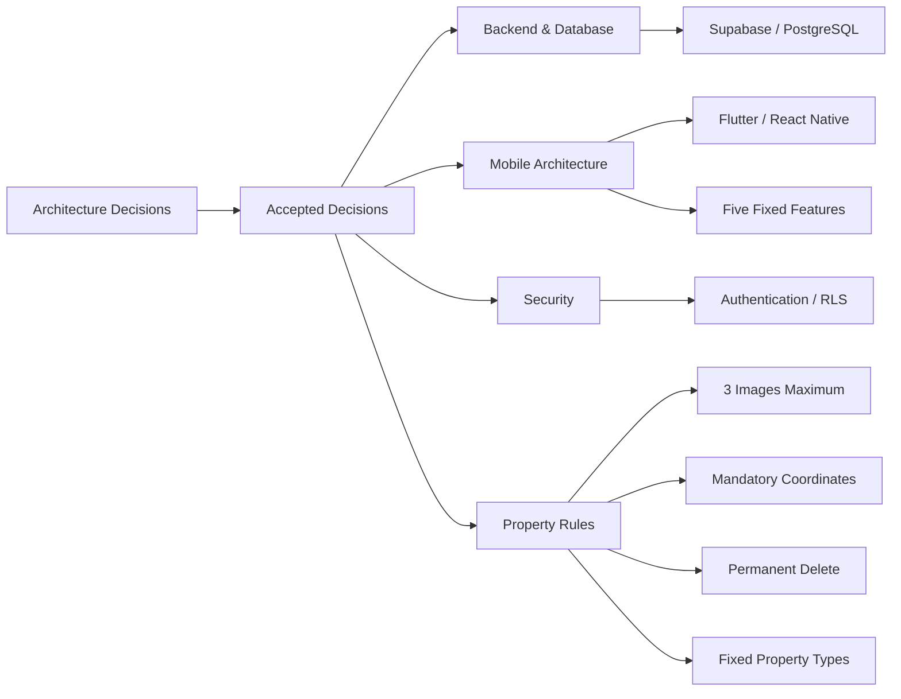

# 04 — Architecture Decisions Diagram

**Project:** Immobilier Services  
**Document:** Architecture Decisions  
**Version:** 1.0  
**Date:** 03 November 2026

---

## 1. Overall Architecture Decisions

## 2. Application Architecture Decisions

## 3. Property Management Decisions

## 4. Security and Data Protection Decisions

## 5. Architecture Decision Map

## 6. Decision Status

---

## 7. Architecture Principles

All architecture decisions follow these principles:

- Simplicity
- Consistency
- Security
- Maintainability
- Scalability
- Scope Control

**Decision Status:** All decisions represented in this document are accepted by the team.